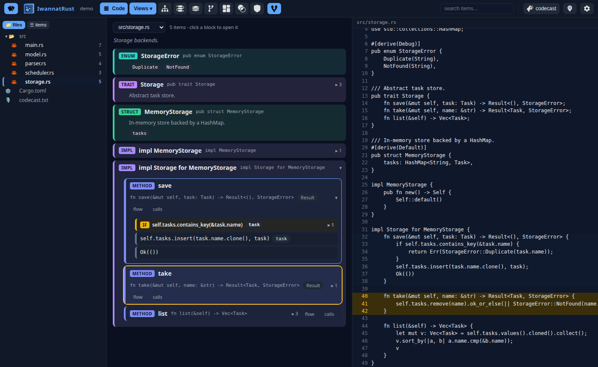

<div align="center">


# IwannatRust

**Understand any codebase in minutes, and give it a presentation that never goes out of date.**

*Rust, C, C++, Go and shell scripts today; [more languages](#supported-languages) on request.*

[](https://www.rust-lang.org)
[](#supported-languages)
[](#supported-languages)
[](#supported-languages)
[](#supported-languages)
[](https://dioxuslabs.com)
[](#how-it-is-built)
[](LICENSE)

</div>

<div align="center">

**▶ IwannatRust in 90 seconds** (sound on), filmed by `codecast video` from
[`codecast/00-in_90_seconds/`](codecast/00-in_90_seconds/01-at-a-glance.md)

</div>

https://github.com/user-attachments/assets/REPLACE-WITH-NEW-VIDEO

## What you can do

- 🗺️ **See any codebase as pictures**: architecture, call tree, control flow, sequence diagrams,
  types & traits, error paths, branch tree. Built from the code, redrawn on every save.
- 🧱 **Read code as nested blocks**, one per item and per step, next to the source: hover either
  side and both light up.
- 🎙️ **Play a *codecast***: a guided talk that switches views, lights up boxes, underlines the
  exact words in the code and zooms in, while a voice explains.
- ✏️ **Draw what the code does not show**: mermaid flowcharts and sequences that reveal themselves,
  scenes where things move and blink on the spoken word, charts that grow, byte layouts, notes the
  voice points into.
- ❓ **Ask while it talks**: click a question, the talk pauses, answers, and goes on.
- 🤖 **Let an AI write it**: `codecast brief` hands an agent your code as compact text, and
  `codecast check` holds every reference against the code, so the talk never goes out of date.
- 🔊 **Give it a voice**: natural voices recorded offline (Kokoro), two speakers, or the browser's;
  play at 0.75× to 2×.
- 🇯🇵 **English and 日本語**: interface, built-in tours and tutorial, plus subtitles in a second language.
- 🌐 **Share it**: a static site (`codecast export`) or one MP4 per part (`codecast video`), in
  32 themes and 31 fonts.
- 🦀 **Rust, C, C++, Go and shell scripts**, mixed in one project if you like.

No codecast yet? The built-in tour explains any project from its code.



## Quick start

```sh
rustup target add wasm32-unknown-unknown
cargo install dioxus-cli --version 0.7.10 --locked
scripts/iwr build                  # web UI + CLI, one binary: target/release/codecast
scripts/iwr self                   # IwannatRust explaining itself, http://127.0.0.1:4321
codecast serve path/to/your/project
```

First start offers the **tutorial** (a five-minute codecast on the project you opened); the
**?** button brings it back. Example script: [codecast/](codecast/), IwannatRust's own tour (read
the files raw: GitHub joins their one-directive-per-line into paragraphs).

## Make a codecast for your project

1. `codecast serve path/to/your/project`, then click **generate** in the top bar.
2. *Write the script with an AI*: answer a few questions (audience, humour, a metaphor…, or leave
   them empty) and **Copy the prompt**.
3. Paste it into your agent (Claude Code, Codex, Cursor…) opened in your project. It reads the code
   and the writing guide, writes `codecast/` and checks it. The app reloads: click **codecast**.

Then, on the same page, record a voice; share with `codecast export path/to/your/project -o site/`
or `codecast video codecast/`.

## Supported languages

| Language | Status |
|---|---|
| Rust | ✅ Supported |
| C | ✅ Supported (tree-sitter; no preprocessing, `.h` files join their `.c`) |
| C++ | ✅ Supported (tree-sitter; classes with their methods, base classes, `try` / `catch` / `throw`; no templates instantiated, no overload resolution) |
| Go | ✅ Supported (tree-sitter; a package is a module, methods under their receiver's type, interfaces with the types that implement them) |
| Shell (sh, bash) | ✅ Supported (tree-sitter; a script is a module, its functions and its own commands; scripts without an extension are told by their `#!` line) |

A project may mix them (a Rust crate with C sources and its scripts). Want Python, PHP,
TypeScript…? Say so in an [issue](https://github.com/AlexandreKarlsson/IwannatRust/issues):
languages people ask for come first.

## Commands

```
codecast serve  PATH          interactive UI, live reload on save
codecast export PATH -o DIR   static site
codecast brief  PATH          the code as compact text, for an AI (or you) to write a codecast
codecast check  codecast.md   every reference must resolve
codecast voice  codecast/     record the codecast with Kokoro
codecast video  codecast/     film each recorded part as an MP4
```

`scripts/iwr` with no argument lists everything. Full list: [docs/cli.md](docs/cli.md).

Keep only the script in git. Recordings and videos are generated and rebuilt from it, so ignore
them in your repository's `.gitignore`:

```gitignore
codecast/**/*.ogg
codecast/**/*.times
codecast/**/*.mp4
```

Publish the videos elsewhere (a release, GitHub Pages) if you want to share them.

## How it is built

All Rust, in one binary with no JavaScript dependencies: the analyzers (`syn` for Rust,
tree-sitter for C, C++, Go and shell scripts), the layout engine (written here), the tour generator and the Dioxus →
WebAssembly UI. The analysis is syntactic (no type checker, no C preprocessor), so it is fast on
any project that parses and right most of the time.
`crates/iwr-core` compiles to wasm and can be used on its own ([docs/embedding.md](docs/embedding.md)).

## Documentation

[User guide](docs/user-guide.md) · [codecast format](docs/codecast.md) ·
[writing a codecast](docs/writing-codecasts.md) · [commenting your code](docs/commenting.md) ·
[CLI](docs/cli.md) · [architecture](docs/architecture.md) · [model](docs/model.md) ·
[development](docs/development.md)

## Skill for AI agents

[`skills/iwr-commenting`](skills/iwr-commenting/SKILL.md) teaches an agent to comment Rust code
so it reads well in IwannatRust. Copy it into your agent's skills folder, e.g. for Claude Code:

```sh
cp -r skills/iwr-commenting ~/.claude/skills/        # all projects
cp -r skills/iwr-commenting <project>/.claude/skills/ # one project
```

Or as a Claude Code plugin: `/plugin marketplace add AlexandreKarlsson/IwannatRust`, then
`/plugin install iwannatrust@iwannatrust`.

## License

MIT
