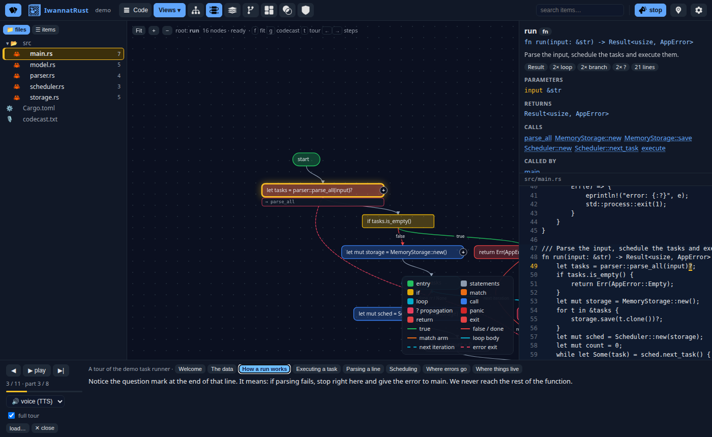
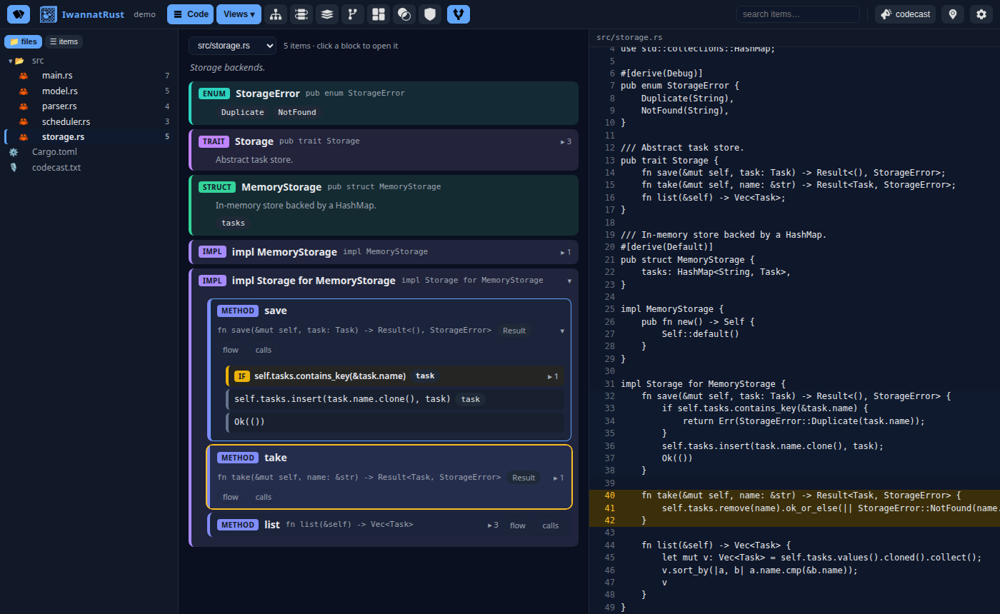

<div align="center">


# IwannatRust

**Understand any Rust project in minutes, and give it a presentation that never goes out of date.**

[](https://www.rust-lang.org)
[](https://dioxuslabs.com)
[](#how-it-is-built)
[](LICENSE)

</div>

## Why

Reading a project you did not write is slow. The docs are thin or out of date, and the person who
knows it is busy. IwannatRust reads the code and gives every project:

- 🗺️ **Drawings built from the code**: files, modules, calls, control flow, types, error paths.
  They are redrawn on every save, so they never go out of date.
- 🎙️ **A virtual presentation (a *codecast*)**: a guided talk that switches to the right view,
  lights up what it is talking about, underlines code, zooms in, and answers questions. It is
  spoken by a recorded voice or the browser, or you read it.
- 👥 **The same explanation for everyone**: newcomers, reviewers, a handover, someone learning
  Rust. The authors write it once, or have an AI write it from `iwr brief`, and `iwr check` keeps
  every reference in sync with the code.

A project without a codecast still gets one: the built-in tour, written from its code.

## Quick start

```sh
rustup target add wasm32-unknown-unknown
cargo install dioxus-cli --version 0.7.10 --locked
scripts/iwr build                  # web UI + CLI, one binary
scripts/iwr serve examples/demo    # opens http://127.0.0.1:4321
```

On first start the app asks whether you have used it before. Answer *no* and the **integrated
tutorial** plays. It is itself a codecast, recorded and shipped with the app, and runs on the
project you opened (about five minutes). The **?** button in the top bar brings it back.

Examples: [examples/demo/codecast/](examples/demo/codecast/) (11 parts, also explains the Rust it
shows) and [codecast/](codecast/), IwannatRust's own tour (`scripts/iwr self`).



## What is in it

| | |
|---|---|
| **Code view** | The file as nested blocks (one per item, one per step), next to the source; hover either side and both light up. |
| **Seven views** | Call tree, control flow, architecture, branch tree, structure, types & traits, error flow. |
| **Codecasts** | Markdown scripts: `@` view, `!` highlight (items, steps, files, folders), `=` underline, `+` enlarge a panel, light up a control or zoom, `?` questions, mermaid sketches, side notes, popups. |
| **Voice** | Kokoro recordings (`iwr voice`, or the *Generate* page), browser TTS, or silent reading; offline translation. |
| **Look** | 32 themes, 31 fonts; a `codecast.toml` sets the author's defaults. |
| **Sharing** | `iwr export` writes a static site that works from any host or sub-path. |



## Commands

```
iwr serve  PATH          interactive UI, live reload on save
iwr export PATH -o DIR   static site
iwr brief  PATH          the code as compact text, for an AI (or you) to write a codecast
iwr check  codecast.md   every reference must resolve
iwr voice  codecast/     record the codecast with Kokoro
```

`scripts/iwr` with no argument lists everything. Full list: [docs/cli.md](docs/cli.md).

## How it is built

All Rust, in one binary with no JavaScript dependencies: the analyzer (`syn`), the layout engine
(written here), the tour generator and the Dioxus → WebAssembly UI. The analysis is syntactic (no
type checker), so it is fast on any crate that parses and right most of the time.
`crates/iwr-core` compiles to wasm and can be used on its own ([docs/embedding.md](docs/embedding.md)).

## Documentation

[User guide](docs/user-guide.md) · [codecast format](docs/codecast.md) ·
[writing a codecast](docs/writing-codecasts.md) · [commenting your code](docs/commenting.md) ·
[CLI](docs/cli.md) · [architecture](docs/architecture.md) · [model](docs/model.md) ·
[development](docs/development.md)

## Skill for AI agents

[`skills/iwr-commenting`](skills/iwr-commenting/SKILL.md) teaches an agent to comment Rust code
so it reads well in IwannatRust. Copy it into your agent's skills folder, e.g. for Claude Code:

```sh
cp -r skills/iwr-commenting ~/.claude/skills/        # all projects
cp -r skills/iwr-commenting <project>/.claude/skills/ # one project
```

Or as a Claude Code plugin: `/plugin marketplace add AlexandreKarlsson/IwannatRust`, then
`/plugin install iwannatrust@iwannatrust`.

## License

MIT
