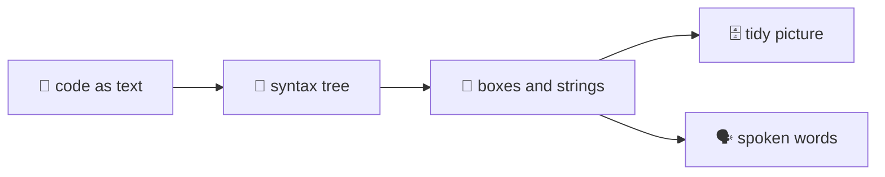

## Welcome
@ arch
+ view
! iwr-core iwr iwr-ui
Hello! This tour is about the clever bits inside IwannatRust: the algorithms. We will explain each one like you are five, with toys.
@ plan
Here is our trip. First, how one box is born. Then how boxes are tied with strings, nested like dolls, found in a phone book, tidied on a shelf, and finally read aloud.

@ diagram
! text tree
Everything starts as plain text, like a story in a book. A helper called syn reads it and turns it into a tree, where every sentence knows its parts.
! boxes
From that tree we build boxes and strings. A box is one step. A string is "and then this happens".
! shelf voice
Then we tidy the boxes into a nice picture, and we teach a robot voice to read them. Every part of this tour is one of those jobs.
@ arch
! iwr-core
All of this lives in one crate, iwr core. It has no screen at all, so it can run in the browser and on the command line alike. Let's open it and watch a box being born.
