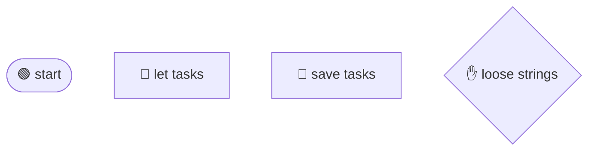

## Loose strings

@ diagram
! start hand
Imagine every brick has a string hanging from it, waiting to be tied to whatever comes next. The builder holds those loose strings in one hand.
> +a
! a
A new brick arrives. The builder ties every loose string in its hand to the new brick, then lets go of them.
> +b
! b
Now the new brick has its own loose string, so the builder picks it up and waits for the next one. Brick after brick, the chain grows.
@ code:iwr-core::cfg::Builder::seq
! iwr-core::cfg::Builder::seq
^ iwr-core::cfg::Builder::seq
In code, that dance is seq, only three steps long. Make the brick, tie the loose strings to it, hold its own string.
! iwr-core::cfg::Builder::seq/b2
Tying happens in flow into. It empties the hand and draws one arrow from each loose string to the new brick.
! iwr-core::cfg::Builder::seq/b3
= crates/iwr-core/src/cfg.rs:207:9-53
And here the new brick's own string goes into the hand. Its kind says next: the plain "and then" arrow.
? Why can the hand hold more than one string?
  Because of forks. After an if, both the yes path and the no path end with a loose string. The next brick must be tied to both, and the hand lets that happen with no special case.
@ code:iwr-core::cfg::Builder::edge
! iwr-core::cfg::Builder::edge/b1 iwr-core::cfg::Builder::edge/b2
One more rule: never tie the same string twice. Before adding an arrow, edge checks whether the very same one is already there.
@ flow:iwr-core::cfg::build
! iwr-core::cfg::build/b6 iwr-core::cfg::build/b7
So build starts by holding the string of start, then walks every statement of the body.
! iwr-core::cfg::build/b9 iwr-core::cfg::build/b15
When the body is done, any string still loose is tied to end. Nothing is ever left dangling. Next, how the builder picks the colour of each brick.
