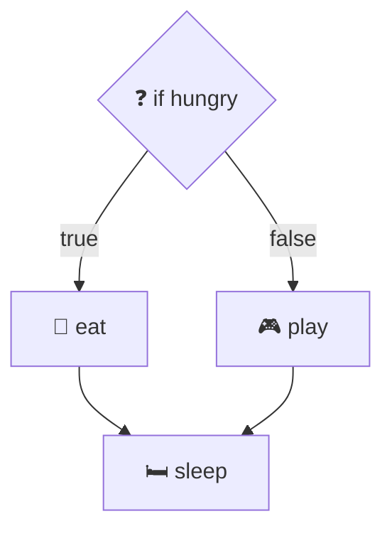

## Forks and circles

@ diagram
! q yes no
An if is a fork in the road. The builder makes one diamond brick, then holds a true string and walks the first path.
! next
When the first path ends, its loose strings are put aside. Then the false path is walked. At the end, both sets of loose strings go back into the hand, and the next brick ties to all of them.
@ code:iwr-core::cfg::Builder::expr
! crates/iwr-core/src/cfg.rs:351-376
= crates/iwr-core/src/cfg.rs:374:17-38
Here it is in code. Notice the two lists joined at the end: that is how the two roads meet again.
! crates/iwr-core/src/cfg.rs:377-403
A match is the same idea with many roads, one per arm. One shortcut: an arm that only hands a value on does not get a brick. It just becomes the label on the string.
= crates/iwr-core/src/cfg.rs:390:24-44
? What is a trivial arm?
  An arm like "Ok of c gives c": it does nothing but pass the value along. A whole brick for that would be noise, so the arrow simply says "Ok of c to c".
@ code:iwr-core::cfg::Builder::loop_node
! iwr-core::cfg::Builder::loop_node/b1 iwr-core::cfg::Builder::loop_node/b3
A loop is a merry go round. The loop brick is made, and the builder writes it on a little list of "loops I am inside", with an empty bag for break strings.
! iwr-core::cfg::Builder::loop_node/b6 iwr-core::cfg::Builder::loop_node/b7
It holds a string called each iteration and walks the body, brick by brick, exactly as before.
! iwr-core::cfg::Builder::loop_node/b9 iwr-core::cfg::Builder::loop_node/b10
= crates/iwr-core/src/cfg.rs:529:33-53
At the end of the body, every loose string goes back up to the loop brick: next iteration. That is the circle.
@ code:iwr-core::cfg::Builder::expr
! crates/iwr-core/src/cfg.rs:433-448
A break drops its string into the loop's bag, labelled with the if that led there. A continue ties straight back to the top of the loop.
@ code:iwr-core::cfg::Builder::loop_node
! iwr-core::cfg::Builder::loop_node/b13 iwr-core::cfg::Builder::loop_node/b16
= crates/iwr-core/src/cfg.rs:534:9-26
When the loop is done, the bag of breaks becomes the new loose strings in the hand. A for or while loop adds one more, called done, for when it simply runs out. Next, a different shape: boxes inside boxes.
