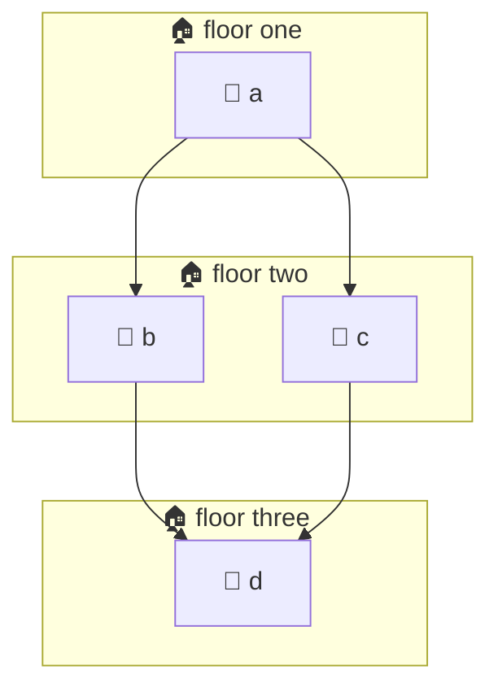

## Tidying the shelf

@ diagram
! f0 f1 f2
Tidying boxes so arrows don't tangle is a famous puzzle. IwannatRust uses the Sugiyama recipe: put boxes on floors, then shuffle each floor so arrows cross less.
@ code:iwr-core::layout::layered_component
! crates/iwr-core/src/layout.rs:184-214
= crates/iwr-core/src/layout.rs:194:16-28
Step one: no circles allowed. We walk the arrows deep first. If an arrow points back at a box we are still exploring, that is a circle, and we turn that arrow around, just for the layout.
! crates/iwr-core/src/layout.rs:215-232
Step two, floors. A box goes one floor below the deepest box pointing at it. A box nobody points at lives on the top floor.
! crates/iwr-core/src/layout.rs:233-257
Step three: a floor with too many boxes is split into two floors, so the picture grows down instead of becoming a very wide line.
! crates/iwr-core/src/layout.rs:258-301
Step four: an arrow that jumps over floors gets invisible stepping stones, one dummy node per floor in between. Now every arrow only joins neighbouring floors.
! crates/iwr-core/src/layout.rs:302-345
= crates/iwr-core/src/layout.rs:321:65-121
Step five, the shuffle. Each box looks at its neighbours on the floor above and moves to their average place, the barycenter. Then the same from below. Up and down, up to twenty four times.
! crates/iwr-core/src/layout.rs:332-338
After each round we count crossings, and keep the best order ever seen, because a round can make things worse.
@ code:iwr-core::layout::transpose
! iwr-core::layout::transpose
= crates/iwr-core/src/layout.rs:602:21-40
Then a last polish: try swapping each pair of neighbours. If the swap removes crossings, keep it. Repeat until nothing improves.
@ code:iwr-core::layout::layered_component
! crates/iwr-core/src/layout.rs:347-406
Step six, real positions. Each floor is centred, then boxes slide toward their neighbours, a little at a time, never overlapping. The stepping stones then slide too, so long arrows come out straight.
? How are crossings counted?
  For each pair of arrows between two floors, look at where they start and where they end. If one starts left of the other but ends right of it, they cross. Count all such pairs.
