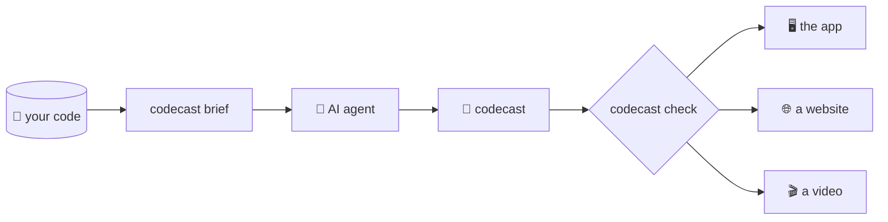

## At a glance
```scene Live reload
grid: 7x3
doc icon 1,2 "📄"
srv 3,2 2x1 "codecast serve"
web 6,2 2x1 "🖥️ browser" :::off
srv --> web
```
```chart Eighteen minutes of voice
bar  x: format  y: size  unit: MB
wav   51.8  "WAV"
mp3   8.6   "MP3"
opus  2.4   "Opus" :::hidden
```

@ types:iwr-core::scene
+ view
! iwr-core::scene::Scene
This is IwannatRust, reading its own code. Here, the types of one module: every box is drawn from the source, and drawn again each time you save.
sp: Nice map. But can it show me what one function does?
@ flow:iwr::check_cast
! iwr::check_cast/b1 iwr::check_cast/b2 iwr::check_cast/b3
+ zoom
Step by step. The voice lights up what it talks about, and zooms right in.
+
@ code:iwr::check_cast
! iwr::check_cast/b3
= crates/iwr/src/main.rs:380:19-48
In the code view, it underlines the exact words: here, every reference of a script is checked against the code.
@ sequence:iwr::serve::reanalyze
+ view
! iwr::serve::analyze_with iwr::serve::check_script
Who calls whom, and in what order? The analysis that runs on every save, as a sequence diagram built from the code, not drawn by hand.
sp: And when the code has no picture?
@ scene
!
Then the script draws one. Save a file {>doc srv}, the server reads it again {*srv 200:#. x4}, and the page redraws itself {=web ok !web}.
@ chart
A chart grows as it is told. The voice is recorded offline: eighteen minutes {!wav !mp3} fit in {+opus !opus} two and a half megabytes, small enough to keep in git.
sp: Who writes all that?
@ diagram
! code brief ai script
An AI agent. codecast brief hands it your code as compact text, and it writes the script.
! script check
codecast check holds every reference against the code, so the talk never goes out of date.
> +site +video
! app site video
Play it in the app, publish it as a website, or film it, like this video.
! code
Rust, C, C++, Go and shell scripts, in English or Japanese. Point it at your project.
