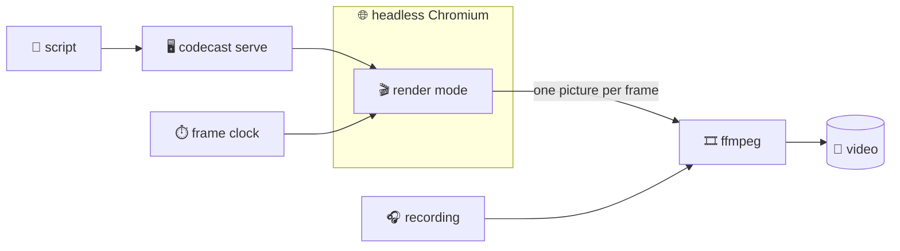

## Filming a codecast

@ diagram
! script voice mp4
^ codecast video
One last trick: the player can film itself. The video command turns every recorded part into a video file, with the pictures and the voice in step, ready to post anywhere.
! server chrome ffmpeg
It needs three helpers: our own server, a Chromium browser with no window, and ffmpeg, which glues pictures and sound together into a video.
sp: Why not simply record the screen while the codecast plays?
! clock player
Because a screen recorder films in real time: a slow frame is lost, and the picture drifts away from the voice. We do stop motion instead. Freeze the scene, take one photo, move time forward by one frame, and again.
@ flow:iwr-ui::player::State::start_render
! iwr-ui::player::State::start_render/b1 iwr-ui::player::State::start_render/b16
In the browser, the player has a render mode. It hides the bars and buttons, keeps the stage, and turns the caption into a subtitle band at the bottom.
= crates/iwr-ui/src/player.rs:985:20-40
Instead of following the audio clock, it waits to be told the time, through one small hook the renderer can call.
? Can it film the Japanese version?
  ^ codecast video --lang ja --sub en
  Yes. The player first translates the script and picks the Japanese recording, and the English text can sit under the caption as subtitles. The page raises a ready flag only once all of that has arrived, so the first frame is never half translated.
@ flow:iwr::video::film
! iwr::video::film/b1 iwr::video::film/b11
On the other side, film opens the part in a tab whose frames we draw ourselves, with time frozen from the start.
! iwr::video::film/b14 iwr::video::film/b20
It waits until the hook exists and the fonts are in, then lets the first cue's camera settle for one second.
! iwr::video::film/b29 iwr::video::film/b31
Then the heart of it: for every frame, tell the player what time it is, run one frame, and take the photo.
@ flow:iwr::video::Frames::step
! iwr::video::Frames::step/b4 iwr::video::Frames::step/b5
step lets the page live for exactly a thirtieth of a second of virtual time. Timers, animations and the player all move together, then everything freezes again.
! iwr::video::Frames::step/b7 iwr::video::Frames::step/b10
= crates/iwr/src/video.rs:357:29-44
Then begin frame draws that moment and hands back its picture. The frame time has to be on Chromium's own clock, or the code moves while the CSS animations stay frozen. That one took a while to find.
sp: So a slow machine just takes longer, but the video comes out the same?
@ flow:iwr::video::film
! iwr::video::film/b23 iwr::video::film/b40
Exactly. Each picture goes down a pipe into ffmpeg, which lays the part's recording under them. On a laptop it films faster than the part plays.
? Why does it run in Docker?
  ^ scripts/iwr video
  Only one build of Chromium lets a program draw the frames itself, and ffmpeg and the fonts must match too. The image carries all of them, so the same command gives the same video on any machine, and nothing gets installed on yours.
@ diagram
! script server chrome player clock ffmpeg voice mp4
And that is the whole loop: the analyzer builds the model, the views draw it, a script points at it, the player glows and speaks, and now it even films itself. Everything you saw in this tour was produced by the code it describes, which is either elegant or suspicious, and we will let you decide.
