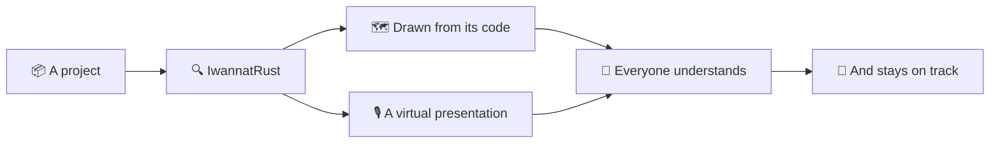

## Welcome

```md Why
- 🧭 **Understand** a project in minutes, not weeks
- 👥 **For everyone**: newcomers, reviewers, the whole team
- 🎙️ **A virtual presentation** of each project, by its authors
- 🔄 **Always on track**: drawn from the code, it follows every change
```
@ diagram
+
! proj
Welcome to IwannatRust. Its goal is simple: make any Rust project much easier to understand, for everyone.
! iwr see
It reads the project and draws it from its own code: its files, its modules, its calls, its types and its errors.
! talk
And it gives each project a virtual presentation: a guided talk that explains its ideas, like a colleague sitting next to you.
| md:Why
! all track
On the right, what it brings. Newcomers, reviewers, the whole team get the same explanation, and since it is drawn from the code, it stays on track when the code changes.
|
!
@ code
This tutorial is itself one of these presentations, called a codecast. It speaks, shows the right view, and lights up what it talks about, on the project you opened.
@ plan
In the middle, the plan. Each part shows one corner of the app. Click a part to jump to it, or let it play.
