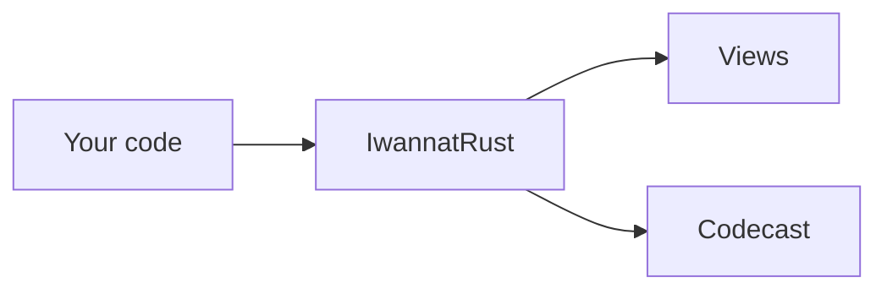

## Sketches and notes

```md Keys
- `g`: play or stop the codecast
- `space`: pause, resume
- `←` `→`: previous, next sentence
- `t`: the full tour
- `f`: fit the view
- `,`: settings
- `Esc`: close, stop
```
@ diagram
! iwr
In the middle, a codecast can draw its own sketch, and light up its boxes as it talks.
! cast
| md:Keys
On the right, it can also show a note next to the view. Here, the keys of the player.
|
!
+ questions
At the bottom, under the text, questions like this one pause the codecast, answer, and then carry on. Try it.
? What is a codecast?
  A markdown script: one sentence per line, with short lines above it that say what to show and what to light up. Anyone can write one, by hand or with an AI.
+
