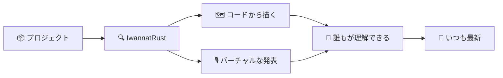

## ようこそ

```md Why
- 🧭 プロジェクトを数週間ではなく、数分で**理解**できます
- 👥 **誰にでも**：新しいメンバー、レビュアー、チーム全員に
- 🎙️ 作者による、各プロジェクトの**バーチャルな発表**
- 🔄 **いつも最新**：コードから描くので、どんな変更にも追従します
```
@ diagram
+
! proj
IwannatRust へようこそ。目的はシンプルです。どんな Rust プロジェクトも、誰にとってもずっとわかりやすくすることです。
! iwr see
プロジェクトを読み込み、そのコードから図を描きます。ファイル、モジュール、呼び出し、型、そしてエラーです。
! talk
さらに、各プロジェクトにバーチャルな発表をつけます。隣に座った同僚のように、考え方を説明してくれるガイド付きの話です。
| md:Why
! all track
右側は、それがもたらすものです。新しいメンバーもレビュアーも、チーム全員が同じ説明を受けられます。コードから描くので、コードが変わっても説明がずれません。
|
!
@ code
このチュートリアル自体も、こうした発表の一つで、コードキャストと呼びます。いま開いているプロジェクトを題材に、話しながら合ったビューを表示し、話している部分をハイライトします。
@ plan
真ん中は構成です。各パートで、アプリの一部を紹介します。パートをクリックするとそこへ移動します。そのまま再生を続けてもかまいません。
