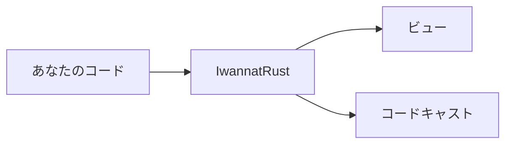

## スケッチとメモ

```md Keys
- `g`：コードキャストを再生・停止
- `space`：一時停止、再開
- `←` `→`：前の文、次の文
- `t`：通しツアー
- `f`：ビューを全体表示
- `,`：設定
- `Esc`：閉じる、停止
```
@ diagram
! iwr
真ん中には、コードキャストが自分で描いたスケッチを表示できます。話に合わせて、ボックスがハイライトされます。
! cast
| md:Keys
右側のように、ビューの横にメモを表示することもできます。ここでは、プレーヤーのキー操作です。
|
!
+ questions
下の文字の下に、このような質問が出ます。クリックするとコードキャストが一時停止して答え、それから続きを再生します。試してみてください。
? コードキャストとは何ですか？
  マークダウンのスクリプトです。一行に一文を書き、その上に、何を表示して何をハイライトするかを示す短い行を置きます。誰でも書けます。手で書いても、人工知能に書かせてもかまいません。
+
