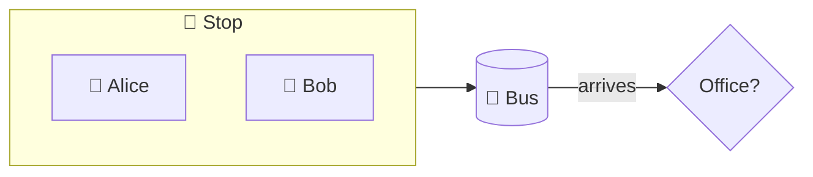

# Codecast

A **script** is spoken text with references to what to show and highlight. The player runs it on top
of the visualizer: switches views, glows the right boxes, highlights and underlines code, and speaks
(browser TTS), plays a recording, or just lets you read. **Questions** appear under the caption
("What is a crate?"); clicking one pauses the codecast, answers, and resumes. Scripts are split into **parts** you can play
independently ("Architecture", "Error handling", …). Any LLM, or a person, can write one from the
**brief**. No API key, no provider, no JSON. Scripts are markdown files: they read fine on GitHub.

```
iwr brief  <path> [--fn P] [--no-body] [--no-overview]   # what the AI reads
iwr guide  <path> [--fn P]  > codecast.md                 # the built-in walkthrough, as a script
iwr check  codecast.md --path <path>                      # every ref must resolve (also: iwr check codecast/)
iwr serve  <path> --script codecast.md [--audio voice.mp3] # play it (also load… in the player bar)
iwr export <path> --script codecast.md [--audio voice.mp3] # bundled in the static site
```

`iwr serve <path>` and `iwr export <path>` pick up a codecast next to the project automatically:
a `codecast/` directory, else `codecast.md`, else the legacy `codecast.txt`.

## Layout: one file or a directory

**One file** (`codecast.md`): the whole script, parts as `##` headings.

**A directory** (`codecast/`), one file per part, so each part can be written, reviewed and recorded alone:

```
codecast/
  index.md            # Title            (+ optional `audio:` for one recording of the whole tour,
                                           `plan: one line` as the intro of the plan page)
                      - [Welcome](01-welcome.md) — what the project is for    optional: the part order
                      - [The data](02-the-data.md) — the types                 as a markdown list; the text
                                                                               after a link is the part's
                                                                               line on the plan page
                                                                               (unlisted files follow, by name)
  01-welcome.md       ## Welcome  …cues…   (no `##`? the file name becomes the part name: "Welcome")
  01-welcome.mp3      recording of that part, picked up by name (mp3/ogg/wav/m4a/webm)
  02-the-data.md
  glossary.md         optional: the project's own glossary (see Questions); never a part
  codecast.toml       optional: the look and defaults (see Look and defaults)
  fonts/              optional: font files codecast.toml names
```

A part file may start with its own `# heading`; after the title in `index.md`, further `#` lines are
ignored. `iwr check codecast/` validates the whole directory;
[examples/demo/codecast/](../examples/demo/codecast/) is one.

## Look and defaults: `codecast.toml`

The author decides what the viewer gets: a `codecast.toml` next to the script (in the `codecast/`
directory, or beside `codecast.md`). Every key is optional.

```toml
theme = "forest"          # one of the 32 built-in themes (list below)
lang = "en"               # language the codecast plays in (en, ja, fr, de, es, it, …)
voice = "tts"             # tts (browser voice), audio (the recording), read (silent, on a timer)
tts_voice = "Samantha"    # browser voice whose name contains this, when the browser has one
rate = 1.1                # speech rate, 0.5..2
tour = true               # play every part in a row
glossary = false          # "What is a…?" questions from the built-in Rust glossary
lock = false              # true: the viewer cannot change theme, fonts, language and voice

[fonts]                   # a bundled font's id, a font file (ttf, otf, woff, woff2) relative to this file, or an installed font's name
title = "lost-tumbler"                 # titles in the graph boxes, headings, the plan page, the side panel, the player
text = "montserrat"                    # the rest of the interface
code = "fonts/FiraCode-Regular.ttf"    # code

[colors]                  # theme variables to override, on top of any theme
accent = "#ff7a00"        # also: bg, panel, panel2, panel3, border, text, muted, hi, hl-bg, sel-bg, code, grid
```

**Defaults, not chains.** A value is applied the first time a browser opens the codecast, and
again whenever the author changes it; a setting the viewer changes afterwards is kept. With
`lock = true`, theme, fonts, language and voice are applied on every load and their controls are greyed
out. A recording still plays by default unless `voice` says `tts` or `read`. `?lang=` in the URL
picks the language unless the codecast locks a `lang`.

**Themes.** `dark`, `light`, `paper`, `midnight`, `forest`, `nord`, `solar`, `dusk`, `dracula`,
`monokai`, `gruvbox`, `gruvbox-light`, `catppuccin`, `latte`, `tokyo`, `onedark`, `github`,
`github-dark`, `rosepine`, `dawn`, `everforest`, `kanagawa`, `ayu`, `synthwave`, `ocean`, `sakura`,
`mint`, `desert`, `coffee`, `matrix`, `cyber`, `contrast`. Settings → Appearance shows each one.

**Fonts.** 31 fonts are bundled with the UI (`crates/iwr-ui/assets/fonts/`, woff2): pick one by
its id, nothing to ship. Settings → Appearance shows them all, drawn in themselves.

| Kind | Ids |
|------|-----|
| Display (titles) | `akieir`, `anak-bocil`, `apoca`, `asal-usul`, `brimful`, `catways`, `cozy-autumns`, `digitalt`, `lost-tumbler`, `north-kids`, `outline-style`, `pasti`, `quango`, `rubintek`, `slow-play`, `super-shiny`, `thesead`, `zerove`, `library-3am`, `aicon` |
| Handwritten | `rahull`, `hey-august`, `mocaroni` |
| Text (whole interface) | `montserrat`, `josefin-sans`, `zt-otez`, `glametrix`, `timeburner`, `ovaline`, `steiner`, `cambai` |

None is monospace: `code` takes an installed font's name or a file. A font of your own goes in
`codecast/fonts/…` (check its licence allows redistribution); `iwr serve` serves it, `iwr export`
copies it to `codecast/` in the site. Box sizes are computed for a regular sans-serif: a very wide
display font can run past its box. An installed font's name only works on machines that have it.

**From the Settings page.** In *Codecast design*, the *Create the codecast configuration* button (*Edit…* once a file exists; the ⓘ next to it explains the file) opens an editor that builds the file without writing TOML:
the theme and the fonts picked from the same galleries as Appearance (plus *your own font
file…* to copy one into `codecast/fonts/`), language, voice, browser voice (from the browser's
list), rate, tour, glossary, lock, and, folded under *Custom colours*, a colour picker per theme variable. Every change previews at once. Under `iwr serve`, *save
codecast.toml* writes it next to the script (rewriting the file: hand-written comments are
lost); in a static site, *download codecast.toml* hands you the file to put there. Saving and
uploading need a codecast next to the project, and only the page served by `iwr serve` on a
loopback address may do it.

**Checks.** `iwr check` (and `serve` / `export` at start) report unknown keys, unknown themes,
languages and voices, a rate out of range, colours that are not colours, unknown colour names, and
font files that are missing or outside the codecast directory.

## Script format

Line based. One spoken line = one cue. Directive lines above a cue attach to it. Everything is
valid markdown: the title and parts are headings, the directives are short lines.

```
# How the demo task runner works        title (first line)
audio: voice.mp3                         optional recording

## Architecture                          part (play it alone)
@ arch                                   show: <view>[:<ref>]       sticky
The demo is four modules around main.    cue: spoken + shown as caption
! crate::parser                          highlight refs (space separated)   sticky; `!` alone clears
The parser turns text lines into tasks.

## Running a task list
audio: 02-running.mp3                    optional recording of this part only
@ flow:crate::run
! crate::run/b1
= src/main.rs:49:17-44                   underline this code            this cue only
^ GET /config/wifi                       popup card: shown, never spoken  this cue only
[12.5] run starts by parsing the input.  optional start time in seconds (recording mode)
! crate::run/b5 crate::run/b6
Every task is saved, in a loop.
// comment lines are ignored
architecture_tour                        generated cues, e.g. every module with its `//!` doc (see Tours)
? What is a crate?                       question offered under this cue (click → pause, answer, resume)
  = src/main.rs:49:17-44                 an answer may carry its own @ ! = directives
  A crate is one library or program…     answer lines are indented (markdown)
```

Roughly 10 tokens of directives per sentence. Directives: a `*_tour` line (generated cues, see [Tours](#tours)), `@` show, `!` highlight, `=` code, `^` [popup](#popups), `[t]` time, `?` question, `+` [enlarge a panel or light up a part of the app](#panels-spots-and-the-file-tree), `##` part, `#` title, `audio:`, `plan:`, `glossary:`, `pronounce:`, `spell:`, for [diagrams](#diagrams) a ```` ```mermaid ```` block plus `>` to move a node, and for the [side panel](#side-panel) `|` with ```` ```bytes ```` / ```` ```md ```` blocks.

**The plan page.** `@ plan` on a cue (the "here is where we go" sentence of a welcome, typically)
shows the codecast's itinerary instead of a view: the parts in order with one line each, the
current one marked, cue and question counts; clicking a part plays it. The line comes from the
description after the part's link in `index.md` (`- [Welcome](01-welcome.md) — what the project is
for`) or from a `plan:` line right under the `##` heading (which wins); without either, the part's
first sentence. A `plan:` line in the header is the page's intro sentence. The player bar's *plan*
button opens the page at any time.

`audio:` before the first part names a recording of the whole script; inside a part, a recording of that
part only (then its `[t]` times count from the start of that file). Names are relative to the script's
directory. A per-part recording wins over the script-level one and over `--audio`.

## Tours

A line holding only a tour name is replaced, when the script is played, checked or spoken, by
cues generated from the project. They stay in sync with the code: rename a module, rewrite its
`//!` doc, and the tour follows.

| Line | Cues |
|------|---------|
| `architecture_tour[:mod]` | `@ arch`, intro (project + crate root `//!`), then per box in reading order (top down = entry point first, foundations last; then left to right): `!` it + its `//!` first paragraph (or what it holds; a doc page in full, see below). Folded boxes say how many modules they hold. |
| `types_tour[:mod]` | `@ types`, then per type (traits, errors, structs, enums): kind, fields / variants / implementors, `///` doc |
| `errors_tour[:mod]` | `@ errors`: each error type + who returns it + `From` conversions; where `?` passes errors up; who handles them; who can panic |
| `entry_tour` | `@ calls:main`: what `main` calls; then `@ structure`: each `pub` item with its doc |
| `flow_tour:fn` | `@ flow:fn`: the function step by step in reading order, each step opened by its `//` comment |
| `todo_tour[:mod]` | `@ code:fn` per stop: each `TODO`/`FIXME`/`XXX`/`HACK` comment, `unsafe`, `unwrap`/`expect`/`panic!` |
| `files_tour[:mod]` | `@ code:<file>` per file: its `//!` doc and what it defines |

`:mod` limits a tour to a module subtree (`types_tour:crate::storage`). At most 20 stops; the
last says how many were left out. Tests are skipped.

**Doc pages.** A `//!` doc with `#` headings, `| tables |` or `- lists` is read in full, not just its
first paragraph: the side panel shows the whole doc (tables, headings) while the text before the
first heading is read, then one cue per heading shows that section and reads it (table rows as
"first cell: header value, …", at most 8; code blocks are only shown). The panel closes at the next
stop without a page. Same in the built-in tour (`g`): the crate doc from the welcome on, each
module's on its stop. Paths and `<placeholders>` are read as "gw slash data slash node".

`@` / `!` / `=` / `|` lines written just above the tour line, and `?` questions just below it,
go to its first cue. Write your own cues around it to introduce and hand over. `iwr check` reports
unknown tour names; `iwr speak` prints the generated text (it reads the project next to the script,
or `--path`).

## Questions

Two sources, kept apart:

- **Written in the script**: a `? Question text` line followed by indented answer lines. The block
  belongs to the cue just above it (or, when it comes after `@` / `!` / `=` lines, to the next cue).
  Indented `@` `!` `=` lines inside the block are applied while the answer is shown, so an answer can
  point at the code it talks about. `iwr check` flags questions without an answer.
- **The built-in Rust glossary** (`crates/iwr-core/glossary.md`, ~30 entries: crate, module, impl,
  trait, enum, match, Option, Result, question mark, ownership, borrow, clone, derive, closure,
  iterator, generics…). When a cue's text says a term (whole word, case-insensitive, plural tolerated),
  "What is a …?" is offered; each term once per session. Off for a script with `glossary: off` in
  its header, or for a viewer who unticks it in Settings.
- **A project glossary**: `glossary.md` next to the script (in the `codecast/` directory, or beside
  `codecast.md`), same format as the built-in one, for the project's own words. Its entries win over
  built-in ones with the same term and may carry `@` `!` `=` directives.

Glossary format: `## term`, optional `aliases: a, b`, optional `ask: …` (default "What is a term?"),
then the answer. Script questions come first, then glossary matches, four chips at most.

While an answer is shown the codecast is paused; the answer is spoken (TTS mode) and the player
resumes by itself when it ends, or on *continue* / `space` / `Esc`. In recording mode the recording
pauses and plays on again afterwards.

## Diagrams

A part can draw its own picture when the code has none: a metaphor, a schema, a protocol, a
physical effect. Write a mermaid flowchart in a fenced block inside the part (GitHub renders it
too), show it with `@ diagram`, glow its nodes with `!` and their ids:

````
## Why tasks queue up

@ diagram
! stop
Think of tasks as passengers waiting at a stop.
! alice bus
Alice boards: the scheduler took the heaviest task first.
````

Supported: `graph LR|TD` (`flowchart` too), nodes `id[box]` `id(round)` `id([pill])` `id((pill))`
`id{diamond}` `id[(store)]` with `"quoted"` labels and `<br>` line breaks, arrows `-->` `---`
`-.->` `==>` with `|label|` or `-- label -->`, `a & b --> c`, `subgraph id[Title] … end` (nested,
`direction LR` inside), `%%` comments, front matter `title:`. Shapes pick the colour: box blue,
round green, pill purple, diamond yellow, store teal; groups are grey boxes behind their members.
Emoji are plain label text. Several blocks in a part: `@ diagram:2`, or `@ diagram:<title>`. Node
ids are letters, digits and `_`; an edge between two glowing nodes glows too. The *Diagram* tab
appears in the top bar while a codecast has shown one. `iwr check` reports lines it cannot read,
`@ diagram` without a block, and `!` refs that are not node ids while a diagram is shown.

**Moving things.** A `>` line above a cue moves a node from that cue on: `> alice bus` puts
`alice` into group `bus` (or next to `bus` when it is a plain node), `> alice` brings it back
to the top level. One move per line, several lines per cue. Moves are sticky inside a part and
replayed from its first cue, so stepping back undoes them; the player glides nodes to their new
place and re-lays the groups out around them. `iwr check` verifies the names.

**Appearing and disappearing.** A node written `copy[📄 copy]:::hidden` is not drawn until a
`> +copy` line shows it; `> -alice` hides one (a hidden group takes its members along), and
`> +a -b` does several at once. Hidden nodes keep their edges for later, so draw the whole story
in one block and reveal it cue by cue.

## Side panel

A second thing next to the view, so the code stays on screen: the bytes it reads, the steps it
follows, a small schema. A `|` line above a cue opens it, sticky inside the part like `>` lines
(stepping back replays them); `|` alone closes it. In the graph views it takes the details panel's
place, in the Code view and the plan page it docks on the right; on a narrow window it floats.

| Line | Shows |
|---|---|
| `\| bytes` · `\| bytes:2` · `\| bytes:Frame` | a ```` ```bytes Frame ```` block of the part: a byte layout |
| `\| md` · `\| md:Steps` | a ```` ```md Steps ```` block: markdown (lists, numbered steps, tables, `###` headings) |
| `\| diagram:2` | a ```` ```mermaid ```` block of the part, drawn small and still |
| `\| example:Body` · `\| json:Body` · `\| csv` | a ```` ```json Body ```` block (also `csv` `tsv` `yaml` `toml` `xml` `http` `sql` `sh` `text`): sample data, csv as a table |
| `\|` | closes the panel |

`!` refs may name the panel's byte fields, diagram nodes, example keys (`"user":`, `user:`, `<user`) or csv columns next to code refs: `! crate::read/b2 len`
glows block `b2` in the code and field `len` in the strip. An answer may carry its own `|` line.

**Byte layouts.** One field per line, `id size [format] description`:

````
```bytes Frame
row: 8                    bytes per row (default 8)
endian: le                default order of number fields (default be, network order)
magic  4    ascii  Magic number `IWR1`
len    u16         Body length              a number type is a size and a format
flags  1           Bit 0: compressed
_      1           Reserved                 `_`: padding, grey, not a ref
body   len  ascii  The payload              size = the value of an earlier field
crc    4    hex    CRC32 of the body
sample: 49 57 52 31 05 00 01 00 68 65 6c 6c 6f de ad be ef
```
````

Sizes: a byte count, a number type (`u8` `u16` `u32` `u64` `i8`…`i64` `f32` `f64`, optional
`le`/`be` suffix), an earlier field's id, or `*` (the rest of the sample, last field only).
Formats: the number types, `ascii`, `hex` (default). The `sample:` line (several are joined; hex
pairs, spaces, `0x` and `:` tolerated) fills the strip and the *value* column: `len = 5`,
`body = "hello"`. Without a sample the strip shows the shape, variable fields as dotted cells.
The panel draws the bytes as a coloured strip with offsets and each field's name, then a table
(field, offset, size, value, description); hovering a byte or a row lights both. `iwr check`
reports unreadable lines, sizes that do not add up to the sample, and `|` lines naming no block.

## Charts

A ```` ```chart <title> ```` block draws a chart; `@ chart[:ref]` fills the view with it, `| chart[:ref]`
puts it in the side panel (ref: the n-th chart of the part, or its title).

```
line  x: version  y: seconds  unit: s     kind: line bar pie donut stack stack%
series: debug release                     optional: one value per series on each row
v1  42  40                                id value… ["label"] [:::hidden]
```

Markers sit in braces inside a cue's text and are never spoken: `Caching cut it {+v2 !v2} a bit.`
`+id` / `-id` show / hide a row, `=id 18` changes its value(s), `!id` glows (`!` alone clears),
`~a>b` a delta badge, `--30 "goal"` a threshold line, `"text"@id` a callout. The parser takes them
out of the text and keeps their place as a fraction of it (`Cue::marks`), so speech, captions,
recordings' text hashes and translations see plain sentences. While playing, a marker fires when
the voice reaches it (TTS word boundaries, else the time spoken; a recording's time into the cue);
a cue reached by hand shows all of its markers. `iwr check` reports chart errors, markers naming
rows no chart of the part has, and markers in a part without a chart.

## Panels, spots and the file tree

**Enlarge a panel.** A `+` line above a cue makes one panel of the screen big and the others small,
from that cue on, until another `+` line or the end of the part. Nothing changes without one, and
the sizes the viewer set by hand come back afterwards.

| Line | Enlarges |
|------|----------|
| `+ files` | the file tree (the sidebar, on its files tab, shown even if the viewer closed it), with bigger rows |
| `+ items` | the item list of the sidebar |
| `+ view` | the view in the middle: the graph, the diagram, the Code view's blocks |
| `+ source` | the source: the details panel next to a graph, the source pane of the Code view |
| `+` | everything back to normal (also `+ none`) |

**Light up a part of the app.** `+` also takes a part of the interface: it gets a ring, the rest
of the screen dims, the player stays readable. Same stickiness as a panel; a line holds one panel
or one spot. This is how the tutorial (itself a codecast, `crates/iwr-ui/assets/tutorial/`) shows
the buttons.

| Spot | Is |
|------|----|
| `brand` · `panel-button` · `views` · `split` · `search` | the app's name, the sidebar button, the Code tab and the views, the source button, the search box |
| `codecast` · `tour` · `generate` · `help` · `settings` | the buttons of the top bar (`generate` only with `iwr serve`) |
| `sidebar-tabs` | the files / items tabs (shows the sidebar) |
| `player` · `caption` · `parts` · `questions` | the player bar, its text, its parts, the questions under the text |
| `voice` · `lang` · `plan-button` | the voice picker, the language picker, the plan button |
| `side` | the side panel (`\|` lines) |

**Zoom like a presenter.** On a big page, `+ zoom` scales the middle of the screen onto what the
cue highlights (`!`: glowing graph nodes, highlighted blocks and lines, files and folders), up to
2.2×, the top bar and the player untouched; it follows the highlight as views move. `+ zoom files`,
`+ zoom side`, `+ zoom search`… zoom onto a panel or a spot instead (a tall one: its top half).
Same stickiness; `+` zooms back out.

```
@ flow:crate::run
! crate::run/b3
+ zoom
Here, the loop that saves every task.
+
```

**Folders and files.** `!` takes files and folders too (`! src/storage/`, `! src/main.rs`). When a
cue highlights one, the file tree closes every folder except the highlighted folders and those on
the way to a highlighted file or folder, glows them and scrolls to the first. Highlighting items,
blocks or lines leaves the tree alone.

```
+ files
! src/storage/
Everything about saving lives in one folder.
! src/main.rs
The entry point sits at the top, next to it.
+
Back to the code.
```

## Popups

Some things must be seen exactly but never read aloud: a path (`/srv/gw`), an endpoint
(`GET /config/wifi`), a command, an identifier with dashes (`gw-config-server`), a config key. A
voice mangles them ("slash serve slash G W", "G W dash config dash server") and a translation
model mangles them worse. Say the idea in words, and put the exact text in a `^` line above the cue:

```
! gw type
^ GET /config/wifi
So it asks for one file, the wifi config. Same header, same serial.
```

Each `^` line is one row of a small card that floats above the caption while that cue plays, and
goes away with the next cue (the viewer can also close it). A row without backticks is shown as
code, as written; a row with backticks is markdown (``^ Answer: `200` with the file``). Several
`^` lines stack in one card. An indented `^` line inside a `?` answer is the answer's own card.

Popups are not part of the spoken text: they are not read, not translated, and not in the hash of a
recording, so adding or editing one never makes a recording out of date. For a longer listing (a
folder tree, a request with headers, a table of rules) use the [side panel](#side-panel).

`iwr check` notes every word of a cue or answer that belongs in a popup instead: hyphenated words
(`gw-config-server`, `Wi-Fi`, `well-formed`), paths (`/data/config.db`, `src/main.rs`) and HTTP
requests (`GET /config/wifi`).

## How code is spoken

TTS would read `crate::parser::parse_all` as "crate colon colon parser colon colon parse underscore
all". The player rewrites code into words before speaking; the caption keeps the code as written,
with a dotted underline and the spoken form as a tooltip (Settings → *show how code is spoken* puts
it in parentheses instead: `parse_all` *(parse all)*). Rules (`iwr-core/src/speech.rs`):

| Written | Spoken |
|---|---|
| `crate::parser::parse_all` · `parse_all` | parse all (module path dropped, snake_case split) |
| `Task::weight` · `Priority::Low` | Task weight · Priority Low |
| `MemoryStorage` · `HashMap` · `INPUT` | Memory Storage · hash map · INPUT (CamelCase split, all-caps kept) |
| `t.clone()` · `storage.save(t.clone())?` | t dot clone · storage dot save of t dot clone, question mark |
| `Option<Task>` · `Result<usize, AppError>` | Option of Task · Result of u size and App Error |
| `&tasks` · `&mut x` · `&self` · `&str` | a reference to tasks · a mutable reference to x · self by reference · string slice |
| `-> T` · `?` · `==` · `&&` · `0..n` · `=>` | returns T · question mark · equals · and · 0 up to n · gives |
| `\|t\| t.weight()` | the closure taking t, t dot weight |
| `println!(…)` · `#[derive(Debug)]` · `'a` · `u32` | print line · the attribute derive of Debug · lifetime a · u 32 |
| `fn` · `mod` · `mut` · `impl` · `dyn` | function · module · mute · impul · dine |

Applied to backtick spans, and to bare words that look like code (`::`, `_`, `()`, `<…>`, leading
`&`, known macros, CamelCase with two humps, primitive types). Plain English is never touched.
After a spoken expression (not a single name) a comma gives TTS a breath when the sentence goes on.

**Pronunciations**: `pronounce: written = spoken` lines in the script header or in `glossary.md`
override the rules (`pronounce: Dioxus = dee ox us`); the script's lines win over the glossary's,
both over the built-in list (IwannatRust, iwr, TTS, usize, str, dyn, impl, enum, println, Vec…).

**Spelled words**: `spell: IP, CoAP, HTTP` (script header or `glossary.md`, commas or spaces) has
those words read letter by letter — "I P", "C O A P" — plurals included (`IPs` → "I P's"). Use it
for acronyms the voice would read as a word. Same as `pronounce: CoAP = C O A P`, shorter.
Common initials are spelled out without any line: `ID`, `IP`, `UID`, `URL`, `API`, `CPU`, `JSON`,
`HTTP`, `HTML`, `SQL`, `TCP`, `DNS`, `SSH`, `CLI`, `OTP`… (`speech::BUILTIN_SPELL`, upper case
only: "the id" in prose stays a word).

```
iwr speak codecast/            # the whole codecast as it will be spoken, to review the TTS text
```

`iwr check` prints a note for a code token whose spoken form still looks like code.

## Languages

A codecast is written once, in English, and played in another language by picking it in the
player bar (or Settings, or `?lang=ja` in the URL). Nothing is translated on disk by iwr: when a language
is picked, the player sends every text a viewer reads or hears (cues, generated tours, questions
and answers, part names, `plan:` lines, side notes, glossary questions) to be translated, and plays
the result. Directives, refs, diagrams and code stay as written.

- **Your own translation first.** `translations/<lang>.json` next to the codecast, made with
  another tool, wins over the model piece by piece (see below); recommended for now.
- **Offline model.** `iwr serve` translates with an [Argos Translate](https://github.com/argosopentech/argos-translate)
  model (CTranslate2, CPU), set up on first use under `~/.cache/iwr/translate` (Python venv,
  ~250 MB per language). Translations are cached there: a codecast is translated once, then only
  edited text. `iwr translate codecast/ --lang ja` does the same from the command line and prints
  the result, to read it (or warm the cache) before playing.
- **Static site.** `iwr export --lang ja,fr` writes `translations/<lang>.json`; without it the
  player says so and plays in English.
- **Code survives.** Code-looking words (`parse_file`, `crate::run`) and project names with a
  capital, `_` or digit (`Project`) are wrapped in backticks before translation, which the model
  copies through; plain lowercase names (`run`, `files`) are prose unless the script backticks them.
- **Voice.** The browser speaks it with a voice of that language (Chrome has Japanese), or a
  recording: `iwr voice codecast/ --lang ja` translates each part the same way and records it with
  Kokoro (`jf_alpha` by default; Japanese phonemes by misaki, installed on first use; code and
  other Latin words read as English) into `NN-part.ja.jf_alpha.ogg` + `.times`, meant to be
  committed next to the English ones. The loader turns them into `audio.ja.jf_alpha:` / `times.ja.jf_alpha:` lines;
  the player plays them in Japanese, TTS speaks the parts without one. The times hash the English
  cues: edit the English text and the Japanese recording goes stale (`iwr check` says so) until
  recorded again. Kokoro also speaks `fr`, `es`, `it`, `pt`.
- Glossary questions are still found from the English text, then shown translated. The player's
  own buttons stay English.

### Translating with another tool

> ⚠ **The offline translation does not work very well for now.** Argos models are small: terms
> get mistranslated, sentences come out stiff, Japanese especially. For a codecast people will
> watch, translate it with another tool (DeepL, Google Translate, an LLM such as Claude) and give
> iwr the result.

The player translates *pieces* (a cue, an answer, a table cell…), looked up by their English text.
Your own translations go in `translations/<lang>.json` next to the codecast (in the `codecast/`
directory, or beside a single-file `codecast.md`): a JSON object, English piece → translation.
Pieces found there are used as they are; the others (empty values, or text edited since) still go
to the offline model. With every piece translated, the model is not even installed.

1. Dump the pieces (no model needed):
   ```
   iwr translate codecast/ --lang ja --pieces > ja.json
   ```
   Every key is an English piece, in reading order; the values are empty (or your translation so
   far, so run it again after editing the script: new pieces show up empty).
2. Translate the values with your tool. With an LLM, a prompt like: *"Translate every value of
   this JSON object into Japanese from its key. Keep the keys unchanged. Keep everything in
   `backticks` exactly as is. Answer with the JSON only."* With DeepL or a CAT tool, translate the
   file as JSON (keys locked). Keep the backticks: they protect code, which is put back unchanged.
3. Save the result as `codecast/translations/ja.json`, check it with
   `iwr translate codecast/ --lang ja` (prints the translated codecast), then play it with
   `iwr serve`, record it with `iwr voice codecast/ --lang ja`, or export it with
   `iwr export --lang ja`. Commit the file with the codecast.

Write for translation either way: short sentences, one idea each, code in backticks.

## Refs

| Ref | Means | Example |
|-----|-------|---------|
| item path | fn, method, struct, enum, trait, impl (`crate::` optional; unique suffix OK) | `crate::run`, `Task::weight`, `parse_all` |
| module path | module (scopes module views, glows the module box) | `crate::storage`, `storage` |
| `<item>/b<n>` | block *n* of that function, ids as printed by `iwr brief` | `crate::run/b5` |
| `<file>` | a whole file (`@ code:src/parser.rs` opens it in the Code view) | `src/parser.rs` |
| `<folder>/` | a folder of the file tree (`!` only; exact path or unique suffix; the `/` keeps a module of the same name from winning) | `src/storage/`, `storage/` |
| `<file>:<l>[-<l>]` | source lines | `src/main.rs:49-52` |
| `<file>:<l>:<c1>-<c2>` | columns on a line (word underline, use with `=`) | `src/main.rs:49:17-44` |

Views: `code` `calls` `flow` `arch` `branches` `structure` `types` `errors`. `@ flow:crate::run` opens the
control flow of `run`; `@ code:crate::run` opens its blocks; `@ types:crate::model` scopes the types
view to that module; `@ errors` keeps the current scope.

A ref resolves to a span, and every view highlights what intersects it: the block and its lines in the
Code view, the matching statement nodes in Control flow / Branch tree, the item's node in Call tree,
Types, Error flow, the module box in Architecture. The script never names UI nodes. Unknown refs are
skipped (`iwr check` lists them).

## Brief

`iwr brief` prints the project as compact text (~4 chars per token): modules with docs, types with fields
or variants, traits with implementors, then each function's signature, facts and body as block lines:

```
fn crate::run  src/main.rs:47-67  "Parse the input, schedule the tasks and execute them."
  fn run(input: &str) -> Result<usize, AppError>   Result · 2 loop · 2 branch · 2×?
  b1 ?      let tasks = parser::parse_all(input)?  ＋tasks  input  → crate::parser::parse_all
  b2 if     if tasks.is_empty()  tasks
  b3   return return Err(AppError::Empty)
  b5 loop   for t in &tasks  ＋t  tasks
  b6   ?    storage.save(t.clone())?  storage t  → crate::storage::Storage::save
```

`b<n> <kind> <label> ＋defined used → callee`. Demo crate: ~2.3k tokens with bodies, ~600 without.
`--fn crate::run` prints one function plus the signatures of what it calls and who calls it.

**Writing one:** give an agent `iwr brief <path> --guide` (the writing guide from
[writing-codecasts.md](writing-codecasts.md) followed by the brief), then `iwr check` its output.

## Player

| Voice | Advance | Notes |
|-------|---------|-------|
| 🔊 TTS | when the utterance ends | browser `speechSynthesis`; markdown/code stripped before speaking |
| 🎧 recording | by time: cue with the largest `[t] ≤` position | `audio:` lines (per part or whole script), `--audio`, or a file picked in *load…*; with per-part recordings the tour continues into the next part's file |
| 📖 read | prev / next, or autoplay (seconds per cue in settings, default 4) | |

**Generated recording (the default way to voice a codecast).** `iwr voice codecast/` speaks every
cue with [Kokoro](https://github.com/thewh1teagle/kokoro-onnx) (open-weight TTS, CPU, ~4× real time)
and writes `NN-part.<voice>.ogg` + `NN-part.<voice>.times` (`01-welcome.am_adam.ogg`) next to each
part file. **Every voice keeps its own files**: record the codecast with two voices and the player
offers both (the *recorded voice* chip under its mode menu lists them with how many parts each
covers; the pick is remembered). A part the picked voice did not record, or whose text changed
since, is spoken by the browser voice, never by another recorded voice: the chip then shows
`⚠ 7/9` and the list names the missing parts. The loader turns them into `audio.en.am_adam:` / `times.en.am_adam:` lines. Older
recordings named `NN-part.ogg` (one per language) are renamed to their voice's name the next time
`iwr voice` runs. Commit both: Opus at ~18 kbps
(`--level 0.95`) is ~2.5 MB for 18 minutes, the browser plays it as is, and viewers need no model.
The `.times` file holds each cue's start time and a hash of its spoken text; the loader turns it
into the part's `times:` line (cue start times in order, a cue's own `[t]` wins), so the `.md` files
stay as written and the player opens in 🎧 mode. When a part's text no longer matches its hashes
the loader leaves its recording out and the player speaks that part with browser TTS, then goes
back to the recordings; `serve` and `iwr check` name such parts. Clips are cached per cue: after an
edit only changed cues are synthesized again.
First run sets up a Python venv (`kokoro-onnx`) and downloads the int8 model (~120 MB) under
`~/.cache/iwr/kokoro` (`IWR_KOKORO` overrides). Parts with a generated tour line are skipped; a
hand-made `NN-part.mp3` stays and plays when no voice is picked. `--force` re-records parts that
are up to date. When the text of a part changes, the Generate page lists its out-of-date recordings
by voice and offers to record them again (same voice, speed, pause and compression) or delete them,
and deletes the recordings of parts whose file is gone. Answers to questions are still
spoken by browser TTS. Options: `--voice af_heart` (Kokoro voice name), `--speed`, `--lang en-us`, `--gap 0.4`.

Parts are buttons in the player bar. With **full tour** ticked (default; also 📍 / `t` in the top bar) playing
continues with the next part until the script ends; unticked, it stops at the end of each part (`next part ▶`).
`load…` accepts pasted text, a script file and an audio file. The 📣 button (or `g`) plays the
project's codecast, or the built-in walkthrough when there is none; `codecast from here` in the
details panel starts the walkthrough at a function. The tutorial (`?` button) is a codecast too.
Keys: `←` `→` step, `space` play/pause, `Esc` close.

`iwr serve` re-reads the script file (or directory) and `glossary.md` on every page load, so edit and refresh.
