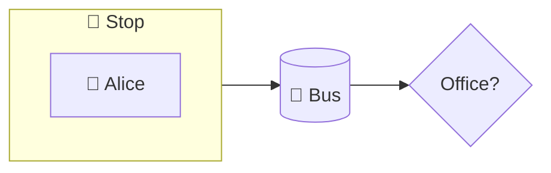

# Writing a codecast (for agents and humans)

A **codecast** is a short spoken tour of a Rust project. The player performs it on top of its views:
switching diagrams, glowing the block being talked about, underlining code.
Input: the **brief** (`codecast brief <path>`). Output: a **script** in the format below, either one
`codecast.md` or a `codecast/` directory: `index.md` (title + part list), one `NN-part-name.md` per
part, optional `glossary.md`, optional `codecast.toml` (starting theme, fonts, voice, language; see
[codecast.md](codecast.md#look-and-defaults-codecasttoml)). Validate: `codecast check <script> --path <path>`.
Hear-check: `codecast speak <script>`.

## Format

```
# <Title>

## <Part name>               one subject, 4–10 cues, playable alone
plan: <one line about it>    optional: its line on the plan page (or write it after the link in index.md)
@ <view>[:<ref>]             what to show (sticky until the next @); `@ plan` shows the plan page
! <ref> [<ref> …]            what to glow (sticky; `!` alone clears); `src/store/` glows a folder: the file tree opens it, closes the rest
+ files|items|view|source    enlarge that panel (sticky in the part; `+` alone: normal; none: no change)
+ search|player|settings|…   or light up that part of the app (list in codecast.md)
+ zoom [files|side|search|…] or zoom in on what `!` lights up (or on that panel / part)
= <file>:<line>:<c1>-<c2>    what to underline in the code (this cue only)
^ <exact text>               popup card with a path, endpoint, command or name (this cue only, never spoken)
> <node> [<group|node>]      diagrams only: move a node from this cue on (sticky in the part)
> +<node> -<node>            diagrams only: show a `:::hidden` node / hide one
| bytes|md|diagram[:<name>]  side panel next to the view (sticky in the part; `|` alone closes)
| chart:<name>               a chart beside the view (`@ chart:<name>` fills the view instead)
{+id !id =id 18 …}           chart markers inside a spoken sentence, fired on that word (see Charts)
<name>_tour[:<ref>]          generated cues (see Tours): architecture types errors entry flow todo files
<One or two spoken sentences.>
sp: <A line said by the second voice>      optional: a question, a doubt, a guess (see Two voices)
? <A question the listener may have>      optional, after the cue it belongs to
  <The answer, indented, two to four sentences; may start with its own @ ! = lines>
```

Views: `code` `calls` `sequence` `flow` `arch` `branches` `structure` `types` `errors`, `diagram` (below).
`@ sequence:crate::run` draws the calls made from `run` in time order (one column per type or module,
loops and branches as frames, titled by the short `//` comment above them, else their code); `!` on a fn ref glows its activation bar and the arrow into it.

Refs: `crate::run` (item) · `crate::run/b5` (block 5 of `run`, ids from the brief) · `crate::storage`
(module) · `src/parser.rs` (file; `@ code:src/parser.rs` opens it) · `src/main.rs:49-52` (lines) ·
`src/main.rs:49:17-44` (columns, 1-based, `c2` inclusive). `crate::` is optional when the name is
unique. `//` starts a comment line.

| Subject | `@` | Good `!` targets |
|---------|-----|------------------|
| big picture, modules, dependencies | `arch` | module refs |
| data model, traits, who implements what | `types[:module]` | struct / enum / trait refs |
| what one function does, step by step | `flow:fn` | `fn/bN` blocks |
| the same, reading like code | `code:fn` | `fn/bN` blocks (parents open automatically) |
| who calls whom from an entry point | `calls:fn` | fn refs |
| all the paths through a function | `branches:fn` | `fn/bN` blocks |
| where errors come from and go | `errors[:module]` | fn and error-enum refs |
| files and impl blocks at a glance | `structure[:module]` | item refs |
| a tour of the files | `code:<file>` per cue | item refs in that file |

## Step 0: comment the code

The player shows the code's own comments: better comments, clearer views, less script. If you may
edit the project, comment first. Full guide with examples: [commenting.md](commenting.md).

| Comment | Put it | Player uses it as |
|---------|--------|-------------------|
| `//!` | top of every file | the module's line in `architecture_tour` and the guide (1st paragraph only) |
| `///` | above every fn / struct / enum / trait | tooltip, details panel, brief, guide |
| `//` | line above a statement, `let`, `if`, `match`, loop | the node's label in `flow` (code moves to hover); opens the guide's step |
| `//` | above an `if` that `break`s / `return`s out of a loop | the label of that exit edge |

`//` labels: one line, directly above (no blank line), ≤ 60 chars, not part of a multi-line `//`
block. Intent, not code: `// Find the next biggest value`, not `// loop over v`. One comment titles
one paragraph of plain statements (up to the next blank line).
`//!`: first sentence says what the module is *for*; blank `//!` line; then details.
`codecast brief` marks modules without one: `(no //! doc)`.

```rust
//! Pick tasks in priority order.

/// Run every task, heaviest first.
pub fn run_all(tasks: &[Task]) -> Result<usize, Error> {
    // Find the next biggest task
    for t in tasks {
        // Out of budget
        if t.cost > budget {
            break;
        }
        …
```

`flow:run_all` then shows a big `run_all` title, one folded loop node "Find the next biggest task",
and its exit edge "Out of budget".

## What `flow` shows

- Top node: the function name, big; signature on hover.
- Box colours say what a statement does: new variable, changes state, input/output, call, return
  (green) / `return Err` (red), program stops (`process::exit`, merged with the `eprintln!` before it).
- Logging macros (`log::info!`, `debug!`…) are hidden unless a `//` comment titles them.
  `let x = match …` is one node; arms that only hand a value on (`Ok(c) => c`) are edge labels.
- Loops start **folded**: one stacked node (comment or loop head), "N steps inside", exit edges
  labelled by the comment or condition leading out (`done` = normal end). The viewer unfolds with ⊕;
  a script cannot. `!` on a block inside a folded loop glows the whole loop. To walk a loop body
  step by step, use `@ code:fn`.

## Tours (generated cues)

A line holding only a tour name becomes cues built from the code at play time, so it stays in sync.

| Line | Becomes |
|------|---------|
| `architecture_tour[:mod]` | `@ arch`, intro (project + crate root `//!`), then per box in reading order (top down = entry point first, foundations last; then left to right): `!` it + its `//!` first paragraph (or what it holds; a doc page in full, see below). Folded boxes say how many modules they hold. |
| `types_tour[:mod]` | `@ types`, then per type (traits, errors, structs, enums): kind, fields / variants / implementors, `///` doc |
| `errors_tour[:mod]` | `@ errors`: each error type + who returns it + `From` conversions; where `?` passes errors up; who handles them; who can panic |
| `entry_tour` | `@ calls:main`: what `main` calls; then `@ structure`: each `pub` item with its doc |
| `flow_tour:fn` | `@ flow:fn`: the function step by step in reading order, each step opened by its `//` comment |
| `todo_tour[:mod]` | `@ code:fn` per stop: each `TODO`/`FIXME`/`XXX`/`HACK` comment, `unsafe`, `unwrap`/`expect`/`panic!` |
| `files_tour[:mod]` | `@ code:<file>` per file: its `//!` doc and what it defines |

`:mod` limits a tour to a module subtree (`types_tour:crate::storage`). At most 20 stops; the last
says how many were left out. Tests are skipped.

**Doc pages.** A `//!` doc with `#` headings, `| tables |` or `- lists` is read in full: the side
panel shows the whole doc while the text before the first heading is read, then one cue per heading
shows and reads that section (table rows as "first cell: header value, …", at most 8; code blocks
only shown). The panel closes at the next stop without a page. Same in the built-in tour (`g`): the
crate doc from the welcome on, each module's on its stop. Paths and `<placeholders>` are read as
"gw slash data slash node".

Directives above a tour line and `?` below it attach to its first cue. Write your own cue before
(why we look) and after (hand-over). Tours suit inventory parts (map, data, errors); hand-write what
needs judgement: why, how parts connect. `flow_tour` is only as good as the `//` comments.
`codecast speak` prints the generated text; `codecast check` flags unknown tours.

## Voice: explain it to a curious twelve-year-old

The listener is smart but new to this code. Aim for "I could explain it to a friend after".

- **Plain words first, jargon second.** Say what happens ("the server writes the order down so it
  survives a crash"), then name it ("that is the write-ahead log").
- **One metaphor per big idea**: a queue is a line at the bakery, a mutex is the bathroom key, a
  channel is a mail slot, a trait is a job description. Say it once, reuse it, drop it when it stops
  fitting. Draw it if it moves (see *Diagrams*).
- **Show data, don't describe it.** An API? Show the request body. A parser? Three lines of the
  file. A table? Two rows. Use an example block (see *Examples*), real-looking values
  (`"ann@example.com"`, not `"string"`), 3–10 lines.
- **Follow one concrete thing.** "Let's follow Ann's order from the click to the database" beats a
  tour of layers. Reuse the same sample across parts.
- **Questions before answers.** "So what happens if the disk is full?", then the code that handles it.
- **Short sentences, active voice, *we*.** "We check the token", not "The token is checked".
- **Speak in sentences, not notes.** "Label: definition" reads fine on a slide but sounds like a
  list read aloud. Not "500: the server has an error" but "The error code 500 is used when the
  server has an issue". Same in answers, `plan:` lines and doc pages written to be read.
- **Say why it matters**: the bug it avoids, the cost it saves. Skip what the listener can't see.

## Two voices (a second speaker)

A line starting with `sp:` is said by a second voice: another browser voice, another Kokoro voice
in the recording (the same voice pitched higher when the language has only one). It is a normal cue
with its own directives above it; the caption sets it apart. Neither voice is the teacher: the
second asks what the listener would ask, guesses wrong, sums up, or takes over a step.

```
@ flow:crate::parse
! crate::parse/b1
We read the file line by line.
sp: Why not all at once?
! crate::parse/b2
Because one line is one task: we never need to look further.
sp: So a broken line only loses that one task?
Exactly, and the next line starts fresh.
```

- **One `sp:` line every three to six cues**, one short sentence, never two in a row.
- It voices a real doubt the next cue answers, or says the takeaway in its own words.
  No "great question", no "as you said".
- Clicked `?` questions are asked by the second voice and answered by the main one: word them like
  something a person would say.

## How to write it

1. **A tour, not a list of facts.** It plays in a row: a *Welcome* part saying what the project is
   for (opening on the architecture, rule 3) and where we will go (`@ plan` on its second cue: the
   player lists the parts, so give each a line after its link in `index.md`), parts that follow
   from each other, a one-sentence wrap-up.
2. **Parts are subjects**, titled like menu entries (*How a request flows*, *Where errors go*,
   *The scheduler*), 4–12 of them. Big picture first, then deeper; for listeners new to Rust, one
   part on the language mechanism the code shows best (ownership, traits).
3. **Set the stage on the first cue.** Audio starts with it, so the screen must move: give it its
   `@` view *and* something to look at (`!` glow, `+ view` / `+ zoom` layout, or `|` panel). Naming
   only the view already shown (the app opens on the architecture) changes nothing; a voice over a
   still screen feels broken. Set all the part needs there: panels left by the viewer's clicking are
   not your layout. Welcome: `@ arch`, crates lit (`! crate_a crate_b`), `+ view`, the whole map
   before any detail. `codecast check` notes parts whose first cue does not set the stage.
4. **One view per part.** Ten cues on one function, moving only the glow, beat jumping between
   views. Change `@` only when the subject really moves, two or three times per part at most.
5. **Link the parts.** End each with a hand-over ("Next, let's see what executing a task means."),
   begin the next by picking it up. The listener should never wonder why the view changed.
6. **One idea per cue**, one or two sentences, ≤ 30 words each (the caption shows them). Connect
   cues naturally: *First, … Then … Notice … Otherwise … Finally …*
7. **Point at code**: `=` on the exact token you talk about (the `?`, the `.await`, a condition).
   At least one per part that walks through code.
8. **Say what it does and why**, not what it is called: "The scheduler picks the heaviest task each
   round" beats "`next_task` returns an `Option<Task>`".
9. **Name the Rust mechanism** the listener may not know (`?` propagation, trait dispatch, ownership
   moves, recursion base case) in one sentence, in place. Use the real words (crate, impl, trait,
   closure…): the glossary then offers a "What is a …?" question by itself.
10. **Add your own `?`** when the answer is specific to this project ("Why does deploy never run?"),
    one or two per part, answered in two to four sentences readable aloud. Recurring project
    vocabulary goes in `codecast/glossary.md`, not repeated in cues.
11. **Every ref must exist**: ids from the brief, never invented line numbers. Prefer block refs
    (`fn/bN`) over line refs; they survive edits.
12. **Write code as code**: `parse_all`, `Task::weight`, `&tasks`, `Option<Task>` are spoken
    "parse all", "Task weight", "a reference to tasks", "Option of Task"; the caption shows the real
    token. Never spell for the voice ("parse underscore all"). Backticks are optional for single
    names. Fix a misread word with `pronounce: written = spoken` in the header; list acronyms read
    letter by letter with `spell: IP, CoAP, HTTP`. Versions (`1.5.0`, `v0.12`) are read in one
    breath: "1 point 5 point 0".
13. **Avoid code in the script.** The player shows the code; point with `@` and `=` and say what it
    does in plain words. Name a function or type when the listener needs it, but never write
    expressions, signatures or snippets into a cue: aloud they become word soup ("a reference to
    self dot tasks dot iter of"). No fenced code blocks for code; example blocks are for data
    (`| json:`, `| md:`), not source.
14. **Say it in words, show it with `^`.** No dashes, paths, endpoints or HTTP verbs in spoken text:
    `gw-config-server` becomes "G W dash config dash server", `/srv/gw` "slash serve slash G W",
    `GET /config/wifi` a shout, and translation makes it worse. Say what it is ("the config server",
    "the data disk", "it asks for its wifi file") and put the exact name in a `^` line above the cue
    (popup card, never spoken). Hyphenated words too: "well formed", "read only", "brand new", "64"
    not "sixty-four". A function name the listener needs goes in `^`, not the sentence.
    `codecast check` notes every offending word.
15. **Say where before what.** When a cue lights up a control or panel (`+ search`, `+ files`),
    start with its place: "At the top right, the search box…", "On the left, the files…".
16. **Zoom on big pages.** A long file or a wide graph: `!` the part, then `+ zoom`, and `+` after.
17. **Be a host, not a textbook.** A light touch of humour tied to the code keeps a listener awake:
    short, kind, no puns that need spelling.

## Diagrams (when the code has no picture)

For a metaphor, a physical effect, a protocol or any schema not in the code, draw it: a
```` ```mermaid ```` flowchart block in the part, `@ diagram` to show it, `!` with node ids to glow.
Shapes set the colour: `[box]` blue · `(round)` green · `([pill])` purple · `{diamond}` yellow ·
`[(store)]` teal; `subgraph id[Title] … end` draws a group. Emoji in labels are fine (`b[🚌 Bus]`).
To show something flowing (a request through layers, a value changing owner), move a node:
`> alice bus` puts it into group `bus` (or next to node `bus`) from that cue on, `> alice` brings it
back to the top; one move per line, undone when the listener steps back. A node written
`copy[📄 copy]:::hidden` waits until `> +copy` draws it (`> -copy` hides it again), so one block can
hold the whole story and reveal it cue by cue. Keep 3–8 nodes, one block per part, and come back to
the code afterwards.

````
## Why tasks queue up

@ diagram
! stop
Think of tasks as passengers waiting at a stop.
> alice bus
! bus
Alice boards: the scheduler took the heaviest task first.
````

For an exchange over time (client and server, threads, a handshake), start the block with
`sequenceDiagram` instead: `participant c as Client` (`actor` too), `c->>+s: request` (`-->>` dotted
reply, `->` no head, `-)` async, `-x` lost; `+` / `-` start and end activation bars),
`Note over c,s: text`, frames `loop` / `alt` / `else` / `opt` / `par` … `end`, `autonumber`.
`@ diagram` shows it; refs are participant ids and messages `m1`, `m2`, … in order, so `! m3` glows
the third arrow and `> -m3 -m4` then `> +m3` reveal them cue by cue (rows keep their place).
Keep 3–6 participants and under 15 messages.

## Side panel (bytes, lists, a small schema)

When the listener needs the code *and* what it reads, put the second in the side panel instead of
switching views. `| bytes:<title>` shows a ```` ```bytes <title> ```` block: one field per line,
`id size [format] description`, optional `sample:` line of hex bytes decoded into each field. `!`
with field ids glows them in the strip and table, alongside code refs on the same line.
`| md:<title>` shows a ```` ```md <title> ```` block (numbered steps, a field table, short notes);
`| diagram:<title>` a small, still mermaid block.

````
## Reading a frame
```bytes Frame
endian: le
magic  4    ascii  Magic number
len    u16         Body length
body   len         The payload
crc    4    hex    CRC32 of the body
sample: 49 57 52 31 05 00 68 65 6c 6c 6f de ad be ef
```
@ code:crate::proto::read_frame
| bytes:Frame
! crate::proto::read_frame/b2 len
The two bytes after the magic say how long the body is.
````

Sizes: a number, a number type (`u8` `u16` `u32` `u64`, `i…`, `f32` `f64`, `le`/`be` suffix), an
earlier field's id (its value), or `*` for what the sample has left. `_` is padding. Use it for
headers, packets, file formats, register maps; skip it when the format is text.

## Examples (a body sent, a file read, a row stored)

Data is easier to see than to describe. A ```` ```json <title> ```` block (also `csv`, `tsv`,
`yaml`, `toml`, `xml`, `http`, `sql`, `sh`, `text`) is an example; `| example:<title>` (or
`| json:<title>`) shows it in the side panel next to the code or diagram, `|` hides it. `!` with a
key (json, yaml, toml, xml, http header) glows its line; with a column name, a csv column. Keep it
short and real; show it on the cue that talks about it, close it when the subject moves on.

````
## Sending an order
```json Order
{
  "user": "ann@example.com",
  "items": [{ "sku": "BREAD-01", "qty": 2 }],
  "pay": "card"
}
```
@ code:crate::api::post_order
| example:Order
! crate::api::post_order/b1 items
The shop sends this little parcel. Each item says what and how many.
|
````

## Charts (a number that changed, a share of a whole)

When the story is a number, show it: build time dropping over versions, each module's share of the
code, before and after a fix. A ```` ```chart <title> ```` block draws a line, bar, pie or stacked
chart; `@ chart:<title>` fills the view, `| chart:<title>` puts it in the side panel next to the
code. Markers in braces inside a spoken sentence fire on the word they sit before and are never
read aloud.

````
## Faster builds
```chart Build time
line  x: version  y: seconds  unit: s
v1  42
v2  35  :::hidden
v3  12  :::hidden
```
@ chart:Build time
! v1
Version one took forty two seconds to build.
Then caching trimmed it {+v2} a little, and parallel builds {+v3 !v3 ~v1>v3} crushed it.
````

**The block.** First line: the kind, the axis names, optional `unit:`.

| Kind | Shows | Rows |
|------|-------|------|
| `line` | a value over time or versions (x values evenly spaced) | `id value` |
| `bar` | values side by side, before and after | `id value` |
| `pie` / `donut` | parts of a whole | `id value` (shares, any total) |
| `stack` / `stack%` | parts of a whole across several groups (`%`: each bar to 100) | `id v1 v2 …` |

Several series (two lines, grouped or stacked bars): a `series: name1 name2 …` line, then one value
per series on each row. The id is the label unless the row ends with `"a label"`. A row ending in
`:::hidden` waits for its `+` marker, like a hidden diagram node.

**Markers.** In `{}` inside the cue text; a `{}` at the start fires with the sentence. Braces inside
backticks, or holding anything else, stay text. A `!` line may also name rows: they glow until a
`!id` marker takes over.

| Marker | Does |
|--------|------|
| `+id` / `-id` | show / hide a point, bar or slice (lines draw to it, bars grow, slices sweep) |
| `=id 18` | change a value: the mark moves to it and its label counts there |
| `!id` | glow it, instead of what glowed before (`!` alone clears) |
| `~a>b` | a delta badge from `a` to `b` (−71%) |
| `--30 "target"` | a threshold line at 30 (the label is optional) |
| `"text"@id` | a short callout on a mark |
| `--` | remove the threshold lines (a `--` with the label of a line already drawn moves that line) |
| `[a..b] "label"` | shade the rows from a to b: a window of time, a check (`[]` removes the shading) |
| `+a..b` / `-a..b` | show / hide every row from a to b at once |
| `+@name` / `-@name` | show / hide a whole series |

**A signal over time.** For a value measured second by second against levels: give the header
`min:` / `max:` (the value axis starts there, not at 0), put each level in its own series listed in
`dash:` (drawn dashed), and hide later ones with `:::hidden` after their name in `series:`. Past 16
rows a line drops its dots and thins its x labels; a glowed row keeps its dot and value.

````
```chart Someone lies down
line  x: seconds  y: level  unit: dB  min: 35  max: 60  dash: presence
series: raw presence:::hidden
s33  38.2 39.8  "33"
s34  44.9 39.8  "34"
s35  53.6 39.8  "35"  :::hidden
…
```
@ chart:Someone lies down
The value jumps over the line {+@presence !s34}, so a check starts {[s34..s48] "check" +s35..s48}.
````

Axes rescale smoothly when a value does not fit. Stepping to a cue by hand fires all its markers;
while playing, each fires as the voice reaches it: browser speech by word boundaries (or elapsed
time if none), recordings by how far the cue's audio has played.

**Guidelines.**
- One chart per part, 3–8 marks. More is a table: put it in a `| md:` panel.
- Reveal, don't dump: start with one or two marks, add the rest as the voice reaches them.
- Say the number in words ("forty two seconds"); the chart shows it, the voice gives it meaning.
  Never read every value.
- Put the marker just before the word carrying the news (`{+v3}` before "crushed"), not at the end.
- Title, axis and series names and `"labels"` are translated with the cues; ids and values are not,
  so give rows a `"label"` when the id is not a word a listener should read. A translated cue keeps
  its markers at the same fraction of the sentence.
- Come back to the code afterwards: a chart backs up a point, it is not the point.

## Example

```
# A tour of the demo task runner

## Welcome
@ arch
+ view
! crate::parser crate::scheduler crate::storage
Welcome to the demo task runner. It reads tasks from text, stores them, and runs them by priority.
!
That is the whole map. Now let's follow a run.

## How a run works
@ flow:crate::run
! crate::run/b1
= src/main.rs:49:41-41
First, run hands the input to the parser. Notice the question mark: if parsing fails, run stops here and passes the error to main.
? What does run return?
  = src/main.rs:48:24-46
  A Result: Ok with the number of tasks run, or Err with what went wrong. Rust has no exceptions, so a function that can fail says so in its signature.
! crate::run/b5 crate::run/b6
Then each task is copied into storage, because storage wants to own it and the loop only borrowed it.
```

## Checklist

- `codecast check` prints "all refs resolve"; every `?` has an indented answer.
- A few `sp:` lines (one every three to six cues, never two in a row).
- Directory form: `index.md` has `# Title` and a `- [Part](NN-file.md)` list in playing order; each
  part file starts with its `## Part name`.
- First part welcomes and says what the project is for; last cue wraps up; each part hands over.
- Every first cue sets the stage (rule 3); `codecast check` prints no "first cue" note. No part over
  twelve cues.
- Data the code sends, reads or stores is shown in an example block, not described.
- A number that changed or a share of a whole is a chart revealed with `{+id}` markers, not a list.
- Each big idea has one metaphor; jargon comes after the plain words.
- Cues are full spoken sentences, not "label: definition" notes.
- Every module has a `//!`, loops and key `if`s a short `//` (if you may edit the code).
- Inventory parts may use tours (`architecture_tour`, `types_tour`, `errors_tour`…).
- Cues talk about the code, never quote it: names at most, no expressions or snippets.
- No dashes, paths, endpoints or HTTP verbs in cues, answers, part names or `plan:` lines (rule 14);
  `codecast check` prints no "hard to say" note.
- `codecast speak` reads well: no "underscore", no "colon colon"; odd words have a `pronounce:`
  line, acronyms a `spell:` one.
