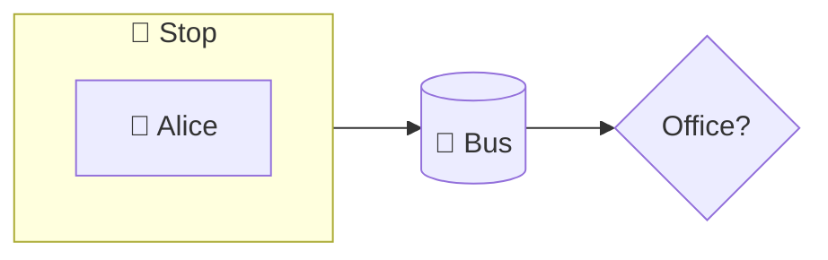

# Writing a codecast (for agents and humans)

A **codecast** is a short spoken tour of a Rust project. The IwannatRust player performs it on top of
its views: switching diagrams, glowing the block being talked about, underlining code. Input: the
**brief** (`codecast brief <path>`). Output: a **script** in the markdown format below, as one `codecast.md`
or a `codecast/` directory (`index.md` with title + part list, one `NN-part-name.md` per part, optional
`glossary.md`, optional `codecast.toml` for the theme, fonts, voice and language the viewer starts
with — see [codecast.md](codecast.md#look-and-defaults-codecasttoml)). Validate with `codecast check <script> --path <path>`, hear-check with `codecast speak <script>`.

## Format

```
# <Title>

## <Part name>               one subject, 4–10 cues, playable alone
plan: <one line about it>    optional: its line on the plan page (or write it after the link in index.md)
@ <view>[:<ref>]             what to show (sticky until the next @); `@ plan` shows the plan page
! <ref> [<ref> …]            what to glow (sticky; `!` alone clears); `src/store/` glows a folder: the file tree opens it, closes the rest
+ files|items|view|source    enlarge that panel (sticky in the part; `+` alone: normal; none: no change)
+ search|player|settings|…   or light up that part of the app (list in codecast.md)
+ zoom [files|side|search|…] or zoom in on what `!` lights up (or on that panel / part)
= <file>:<line>:<c1>-<c2>    what to underline in the code (this cue only)
^ <exact text>               popup card with a path, endpoint, command or name (this cue only, never spoken)
> <node> [<group|node>]      diagrams only: move a node from this cue on (sticky in the part)
> +<node> -<node>            diagrams only: show a `:::hidden` node / hide one
| bytes|md|diagram[:<name>]  side panel next to the view (sticky in the part; `|` alone closes)
| chart:<name>               a chart beside the view (`@ chart:<name>` fills the view instead)
{+id !id =id 18 …}           chart markers inside a spoken sentence, fired on that word (see Charts)
<name>_tour[:<ref>]          generated cues (see Tours): architecture types errors entry flow todo files
<One or two spoken sentences.>
sp: <A line said by the second voice>      optional: a question, a doubt, a guess (see Two voices)
? <A question the listener may have>      optional, after the cue it belongs to
  <The answer, indented, two to four sentences; may start with its own @ ! = lines>
```

Views: `code` `calls` `flow` `arch` `branches` `structure` `types` `errors`, and `diagram` (below).
Refs: `crate::run` (item) · `crate::run/b5` (block 5 of `run`, ids as in the brief) · `crate::storage`
(module) · `src/parser.rs` (file; `@ code:src/parser.rs` opens it) · `src/main.rs:49-52` (lines) ·
`src/main.rs:49:17-44` (columns, 1-based, `c2` inclusive). `crate::` may be omitted when the name
is unique. `//` starts a comment line.

| Subject | `@` | Good `!` targets |
|---------|-----|------------------|
| big picture, modules, dependencies | `arch` | module refs |
| data model, traits, who implements what | `types[:module]` | struct / enum / trait refs |
| what one function does, step by step | `flow:fn` | `fn/bN` blocks |
| the same, reading like code | `code:fn` | `fn/bN` blocks (parents open automatically) |
| who calls whom from an entry point | `calls:fn` | fn refs |
| all the paths through a function | `branches:fn` | `fn/bN` blocks |
| where errors come from and go | `errors[:module]` | fn and error-enum refs |
| files and impl blocks at a glance | `structure[:module]` | item refs |
| a tour of the files | `code:<file>` per cue | item refs in that file |

## Step 0: comment the code

The player shows the code's own comments. Better comments = clearer views and less script to write.
If you may edit the project, comment first, then write the script. The full guide, with examples
and what each comment turns into on screen: [commenting.md](commenting.md).

| Comment | Put it | Player uses it as |
|---------|--------|-------------------|
| `//!` | top of every file | the module's line in `architecture_tour` and the guide (1st paragraph only) |
| `///` | above every fn / struct / enum / trait | tooltip, details panel, brief, guide |
| `//` | line above a statement, `let`, `if`, `match`, loop | the node's label in `flow` (code moves to hover); opens the guide's step |
| `//` | above an `if` that `break`s / `return`s out of a loop | the label of that exit edge |

`//` label rules: one line, directly above (no blank line), ≤ 60 chars, not part of a multi-line
`//` block. Write intent, not code: `// Find the next biggest value`, not `// loop over v`.
One comment titles one paragraph of plain statements (up to the next blank line).
`//!` rule: first sentence says what the module is *for*; blank `//!` line; then details.
`codecast brief` marks modules without one: `(no //! doc)`.

```rust
//! Pick tasks in priority order.

/// Run every task, heaviest first.
pub fn run_all(tasks: &[Task]) -> Result<usize, Error> {
    // Find the next biggest task
    for t in tasks {
        // Out of budget
        if t.cost > budget {
            break;
        }
        …
```

In `flow:run_all` this shows: a big `run_all` title; one folded loop node "Find the next biggest
task"; its exit edge "Out of budget".

## What `flow` shows

- Top node: the function name, big. Signature on hover.
- Box colours say what a statement does: new variable, changes state, input/output, call, return
  (green) / `return Err` (red), program stops (`process::exit`, merged with the `eprintln!` before it).
- Logging macros (`log::info!`, `debug!`…) are hidden unless a `//` comment titles them.
  `let x = match …` is one node; arms that only hand a value on (`Ok(c) => c`) are edge labels.
- Loops start **folded**: one stacked node (comment or loop head), "N steps inside", exit edges
  labelled by the comment or condition that leads out (`done` = normal end). The viewer unfolds
  with ⊕; a script cannot. `!` on a block inside a folded loop glows the whole loop. To walk a
  loop body step by step, use `@ code:fn`.

## Tours (generated cues)

A line holding only a tour name becomes cues built from the code at play time. It stays in sync
with the code.

| Line | Becomes |
|------|---------|
| `architecture_tour[:mod]` | `@ arch`, intro (project + crate root `//!`), then per box in reading order (top down = entry point first, foundations last; then left to right): `!` it + its `//!` first paragraph (or what it holds; a doc page in full, see below). Folded boxes say how many modules they hold. |
| `types_tour[:mod]` | `@ types`, then per type (traits, errors, structs, enums): kind, fields / variants / implementors, `///` doc |
| `errors_tour[:mod]` | `@ errors`: each error type + who returns it + `From` conversions; where `?` passes errors up; who handles them; who can panic |
| `entry_tour` | `@ calls:main`: what `main` calls; then `@ structure`: each `pub` item with its doc |
| `flow_tour:fn` | `@ flow:fn`: the function step by step in reading order, each step opened by its `//` comment |
| `todo_tour[:mod]` | `@ code:fn` per stop: each `TODO`/`FIXME`/`XXX`/`HACK` comment, `unsafe`, `unwrap`/`expect`/`panic!` |
| `files_tour[:mod]` | `@ code:<file>` per file: its `//!` doc and what it defines |

`:mod` limits a tour to a module subtree (`types_tour:crate::storage`). At most 20 stops; the
last says how many were left out. Tests are skipped.

**Doc pages.** A `//!` doc with `#` headings, `| tables |` or `- lists` is read in full, not just its
first paragraph: the side panel shows the whole doc (tables, headings) while the text before the
first heading is read, then one cue per heading shows that section and reads it (table rows as
"first cell: header value, …", at most 8; code blocks are only shown). The panel closes at the next
stop without a page. Same in the built-in tour (`g`): the crate doc from the welcome on, each
module's on its stop. Paths and `<placeholders>` are read as "gw slash data slash node".

Directives above the line and `?` questions below it attach to its first cue. Write your own cue
before it (why we look) and after it (hand-over). Use them for the
inventory parts (map, data, errors) and write by hand what needs judgement: why, how parts connect.
`flow_tour` is only as good as the function's `//` comments. `codecast speak` prints the generated text; `codecast check` flags unknown tours.

## Voice: explain it to a curious twelve-year-old

The listener is smart but new to this code. Aim for "I could explain it to a friend after".

- **Plain words first, jargon second.** Say what happens ("the server writes the order down so it
  survives a crash"), then name it ("that is the write-ahead log").
- **One metaphor per big idea**: a queue is a line at the bakery, a mutex is the bathroom key, a
  channel is a mail slot, a trait is a job description. Say it once, reuse it, drop it when it
  stops fitting. Draw it if it moves (see *Diagrams*).
- **Show, don't describe data.** Talking about an API? Show the request body. A file parser? Show
  three lines of the file. A table? Show two rows. Use an example block (see *Examples*), real-looking
  values (`"ann@example.com"`, not `"string"`), 3–10 lines.
- **Follow one concrete thing.** "Let's follow Ann's order from the click to the database" beats a
  tour of layers. Reuse the same sample across parts.
- **Questions before answers.** "So what happens if the disk is full?" then the code that handles it.
- **Short sentences, active voice, *we*.** "We check the token" not "The token is checked".
- **Say why it matters**: the bug it avoids, the cost it saves. Skip what the listener can't see.

## Two voices (a second speaker)

A line starting with `sp:` is said by a second voice: another browser voice, another Kokoro
voice in the recording (the same voice spoken higher when the language has only one). It is any
cue, with its own directives above it; the caption sets it apart. Neither voice is the teacher:
the second one asks what the listener would ask, guesses wrong, sums up, or takes over a step.

```
@ flow:crate::parse
! crate::parse/b1
We read the file line by line.
sp: Why not all at once?
! crate::parse/b2
Because one line is one task: we never need to look further.
sp: So a broken line only loses that one task?
Exactly, and the next line starts fresh.
```

- **One `sp:` line every three to six cues**, short (one sentence), never two in a row.
- It voices a real doubt the next cue answers, or says the takeaway in its own words.
  No "great question", no "as you said".
- Clicked `?` questions are asked by the second voice too, and answered by the main one: keep
  their wording like something a person would say.

## How to write it

1. **A tour, not a list of facts.** The script plays in a row: a *Welcome* part saying what the
   project is for (opening on the architecture, see rule 3) and where we will go (put `@ plan` on
   that second cue: the player shows the parts as a list, so give each one a line after its link in
   `index.md`), parts that follow from each other,
   a one-sentence wrap-up.
2. **Parts are subjects**, with titles a listener would pick from a menu (*How a request flows*,
   *Where errors go*, *The scheduler*), 4–12 of them. First the big picture, then deeper; for a
   listener new to Rust, one part on the language mechanism the code shows best (ownership, traits).
3. **Set the stage on the first cue.** The audio starts with it, so the screen must move with it:
   give the part's first cue its `@` view *and* something to look at, a `!` glow, a `+ view` /
   `+ zoom` layout or a `|` side panel. A first cue that only names the view the viewer is already
   on (the app opens on the architecture) changes nothing, and a voice talking over a still screen
   feels broken. Set everything the part needs from that first cue: panels left from the viewer's
   own clicking are not your layout. The Welcome part opens best on `@ arch` with the crates lit
   (`! crate_a crate_b`) and the view enlarged (`+ view`): the whole map, before any detail.
   `codecast check` notes every part whose first cue does not set the stage.
4. **One view per part.** Ten cues on one function, moving only the glow, beat jumping between views.
   Change `@` only when the subject really moves, two or three times per part at most.
5. **Link the parts.** End each with a hand-over ("Next, let's see what executing a task means."),
   begin the next by picking it up. The listener should never wonder why the view changed.
6. **One idea per cue**, one or two sentences, ≤ 30 words each (the listener sees the caption).
   Connect cues naturally: *First, … Then … Notice … Otherwise … Finally …*
7. **Point at code**: `=` on the exact token you are talking about (the `?`, the `.await`, a
   condition). At least one per part that walks through code.
8. **Say what it does and why**, not what it is called: "The scheduler picks the heaviest task
   each round" beats "`next_task` returns an `Option<Task>`".
9. **Name the Rust mechanism** the reader may not know (`?` propagation, trait dispatch, ownership
   moves, recursion base case), one sentence, in place. Use the real words (crate, impl, trait,
   closure…): the player's glossary then offers a "What is a …?" question by itself.
10. **Add your own `?`** when the answer is specific to this project ("Why does deploy never run?"),
   one or two per part, with an answer of two to four sentences readable aloud. Recurring project
   vocabulary goes in `codecast/glossary.md`, not repeated in cues.
11. **Every ref must exist**: ids from the brief, never invented line numbers. Prefer block refs
    (`fn/bN`) over line refs; they survive edits.
12. **Write code as code**: `parse_all`, `Task::weight`, `&tasks`, `Option<Task>` are spoken as
    "parse all", "Task weight", "a reference to tasks", "Option of Task", and the caption shows the
    real token. Never spell for the voice ("parse underscore all"). Backticks are optional for single
    names. Fix a word the voice gets wrong with `pronounce: written = spoken`
    in the header, and list acronyms to read letter by letter with `spell: IP, CoAP, HTTP`.
    Version numbers (`1.5.0`, `v0.12`) are read in one breath: "1 point 5 point 0".
13. **Avoid code in the script.** The player already shows the code; point at it with `@` and `=`
    and say what it does in plain words. Name a function or type when the listener needs the
    name, but never write expressions, signatures or snippets into a cue: read aloud they become
    word soup ("a reference to self dot tasks dot iter of"). No fenced code blocks for code either;
    example blocks are for data (`| json:`, `| md:`), not source.
14. **Say it in words, show it with `^`.** Spoken text has no dashes, no paths, no endpoints and
    no HTTP verbs. A voice reads `gw-config-server` as "G W dash config dash server", `/srv/gw` as
    "slash serve slash G W", `GET /config/wifi` as a shout; a translation model breaks them further.
    Say what the thing is ("the config server", "the data disk", "it asks for its wifi file") and
    put the exact name in a `^` line above the cue: the viewer sees it in a popup card, the voice
    never says it. Hyphenated English words too: "well formed", "read only", "brand new", "64"
    instead of "sixty-four". Name a function only when the listener needs it, and then in a `^` line
    rather than in the sentence. `codecast check` notes every word that breaks this rule.
15. **Say where before what.** When a cue lights up a control or a panel (`+ search`, `+ files`),
    start with its place: "At the top right, the search box…", "On the left, the files…".
16. **Zoom on big pages.** A long file or a wide graph: `!` the part, then `+ zoom`, and `+` after.
17. **Be a host, not a textbook.** A light touch of humour tied to the code keeps a listener awake:
    short, kind, and no puns that need spelling.

## Diagrams (when the code has no picture)

For a metaphor, a physical effect, a protocol or any schema that is not in the code, draw it: a
```` ```mermaid ```` flowchart block in the part, `@ diagram` to show it, `!` with node ids to glow.
Shapes set the colour: `[box]` blue · `(round)` green · `([pill])` purple · `{diamond}` yellow ·
`[(store)]` teal; `subgraph id[Title] … end` draws a group. Emoji in labels are fine (`b[🚌 Bus]`).
To show something flowing (a request through layers, a value changing owner), move a node:
`> alice bus` puts it into group `bus` (or next to node `bus`) from that cue on, `> alice` brings
it back to the top; one move per line, undone when the listener steps back. A node written
`copy[📄 copy]:::hidden` waits until `> +copy` draws it (`> -copy` hides it again), so one block
can hold the whole story and reveal it cue by cue. Keep 3–8 nodes, one block per part, and come
back to the code afterwards.

````
## Why tasks queue up

@ diagram
! stop
Think of tasks as passengers waiting at a stop.
> alice bus
! bus
Alice boards: the scheduler took the heaviest task first.
````

## Side panel (bytes, lists, a small schema)

When the listener needs two things at once, the code *and* what it reads, put the second one in
the side panel instead of switching views. `| bytes:<title>` shows a ```` ```bytes <title> ````
block: one field per line, `id size [format] description`, and an optional `sample:` line of hex
bytes decoded into each field. `!` with field ids glows them in the strip and the table, next to
the code refs on the same line. `| md:<title>` shows a ```` ```md <title> ```` block (a numbered
list of steps, a table of fields, short notes); `| diagram:<title>` a small, still mermaid block.

````
## Reading a frame
```bytes Frame
endian: le
magic  4    ascii  Magic number
len    u16         Body length
body   len         The payload
crc    4    hex    CRC32 of the body
sample: 49 57 52 31 05 00 68 65 6c 6c 6f de ad be ef
```
@ code:crate::proto::read_frame
| bytes:Frame
! crate::proto::read_frame/b2 len
The two bytes after the magic say how long the body is.
````

Sizes: a number, a number type (`u8` `u16` `u32` `u64`, `i…`, `f32` `f64`, `le`/`be` suffix),
an earlier field's id (its value), or `*` for whatever the sample has left. `_` is padding.
Use it for headers, packets, file formats, register maps; skip it when the format is text.

## Examples (a body sent, a file read, a row stored)

Data is easier to see than to describe. A ```` ```json <title> ```` block (also `csv`, `tsv`, `yaml`,
`toml`, `xml`, `http`, `sql`, `sh`, `text`) is an example; `| example:<title>` (or `| json:<title>`)
shows it in the side panel next to the code or diagram, `|` hides it again. `!` with a key (json,
yaml, toml, xml, http header) glows its line; with a column name it glows a csv column. Keep it short
and real; show it on the cue that talks about it, close it when the subject moves on.

````
## Sending an order
```json Order
{
  "user": "ann@example.com",
  "items": [{ "sku": "BREAD-01", "qty": 2 }],
  "pay": "card"
}
```
@ code:crate::api::post_order
| example:Order
! crate::api::post_order/b1 items
The shop sends this little parcel. Each item says what and how many.
|
````

## Charts (a number that changed, a share of a whole)

When the story is a number, show it: build time going down over versions, how much of the code
each module holds, before and after a fix. A ```` ```chart <title> ```` block draws a line, bar,
pie or stacked chart; `@ chart:<title>` fills the view with it, `| chart:<title>` puts it in the
side panel next to the code. The chart moves with the voice: markers in braces inside a spoken
sentence fire on the word they sit before, and are never read aloud.

````
## Faster builds
```chart Build time
line  x: version  y: seconds  unit: s
v1  42
v2  35  :::hidden
v3  12  :::hidden
```
@ chart:Build time
! v1
Version one took forty two seconds to build.
Then caching trimmed it {+v2} a little, and parallel builds {+v3 !v3 ~v1>v3} crushed it.
````

**The block.** The first line is the kind, then the axis names and an optional `unit:`:

| Kind | Shows | Rows |
|------|-------|------|
| `line` | a value over time or versions (x values evenly spaced) | `id value` |
| `bar` | values side by side, before and after | `id value` |
| `pie` / `donut` | parts of a whole | `id value` (shares, any total) |
| `stack` / `stack%` | parts of a whole across several groups (`%`: each bar to 100) | `id v1 v2 …` |

Several series (two lines, grouped or stacked bars): a `series: name1 name2 …` line, then one value
per series on each row. The id is also the label unless the row ends with `"a label"`. A row
ending in `:::hidden` waits for its `+` marker, like a hidden diagram node.

**Markers.** Write them in `{}` inside the cue text; a `{}` at the start of the sentence fires with it.
Braces inside backticks, or holding anything else, stay text. A `!` line may also name rows: they
glow until a `!id` marker takes over.

| Marker | Does |
|--------|------|
| `+id` / `-id` | show / hide a point, bar or slice (lines draw to it, bars grow, slices sweep) |
| `=id 18` | change a value: the mark moves to it and its label counts there |
| `!id` | glow it, instead of what glowed before (`!` alone clears) |
| `~a>b` | a delta badge from `a` to `b` (−71%) |
| `--30 "target"` | a threshold line at 30 (the label is optional) |
| `"text"@id` | a short callout on a mark |

Axes rescale smoothly when a new value does not fit. Stepping to a cue by hand shows it with all
its markers fired; while playing, each one fires as the voice reaches it: browser speech by its
word boundaries (or the time spoken when the browser gives none), recordings by how far the cue's
audio has played.

**Guidelines.**
- One chart per part, 3–8 marks. More than that is a table: put it in a `| md:` panel.
- Reveal, don't dump: start with one or two marks and add the rest as the voice reaches them.
- Say the number in words in the cue ("forty two seconds"); the chart shows it, the voice gives
  it meaning. Never read every value.
- Put the marker just before the word that carries the news (`{+v3}` before "crushed"), not at
  the end of the sentence.
- Title, axis and series names and `"labels"` are translated with the cues; ids and values are
  not, so give rows a `"label"` when the id is not a word a listener should read. A translated cue
  keeps its markers at the same fraction of the sentence.
- Come back to the code afterwards: a chart backs up a point, it is not the point.

## Example

```
# A tour of the demo task runner

## Welcome
@ arch
+ view
! crate::parser crate::scheduler crate::storage
Welcome to the demo task runner. It reads a list of tasks from text, stores them, and runs them in priority order.
! crate::parser
The parser turns text lines into tasks. It is the first thing the program touches, and the first place things can go wrong.
!
That is the whole map. Now let's follow the program as it runs.

## How a run works
@ flow:crate::run
! crate::run
Everything starts in main, which only calls run. So run is where the story is, and we will stay here for a while.
! crate::run/b1
= src/main.rs:49:41-41
First, run hands the input to the parser. Notice the question mark: if parsing fails, run stops right here and gives the error to main.
? What is run's return type?
  = src/main.rs:48:24-46
  A Result of usize and AppError: Ok with the number of tasks that ran, or Err with what went wrong. Rust has no exceptions, so a function that can fail says so in its signature.
! crate::run/b5 crate::run/b6
= src/main.rs:55:22-30
Then every parsed task is saved into storage, one per loop iteration. `t.clone()` makes a copy, because the storage wants to own its task and the loop only borrowed it.
```

## Checklist

- `codecast check` prints "all refs resolve"; every `?` has an indented answer.
- A few `sp:` lines let a second voice ask or sum up (one every three to six cues, never two in a row).
- Directory form: `index.md` has `# Title` and a `- [Part](NN-file.md)` list in playing order; each
  part file starts with its `## Part name`.
- First part welcomes and says what the project is for; last cue wraps up; each part hands over.
- First cue of every part sets the stage: `@` plus a `!`, `+` or `|` (Welcome: `@ arch`, crates
  lit, `+ view`); `codecast check` prints no "first cue" note. No part longer than twelve cues.
- Data the code sends, reads or stores is shown with an example block, not described.
- A number that changed or a share of a whole is a chart revealed with `{+id}` markers, not a list of figures.
- Each big idea has one metaphor; jargon comes after the plain words.
- Every module has a `//!`, loops and key `if`s have a short `//` (if you may edit the code).
- Inventory parts may use tours (`architecture_tour`, `types_tour`, `errors_tour`…) instead of hand-written cue lists.
- Cues talk about the code, they do not quote it: names at most, no expressions or snippets.
- No dashes, paths, endpoints or HTTP verbs in cues, answers, part names or `plan:` lines; exact
  names go in `^` popups. `codecast check` prints no "hard to say" note.
- `codecast speak` reads well: no "underscore", no "colon colon"; odd words have a `pronounce:` line, acronyms a `spell:` one.
